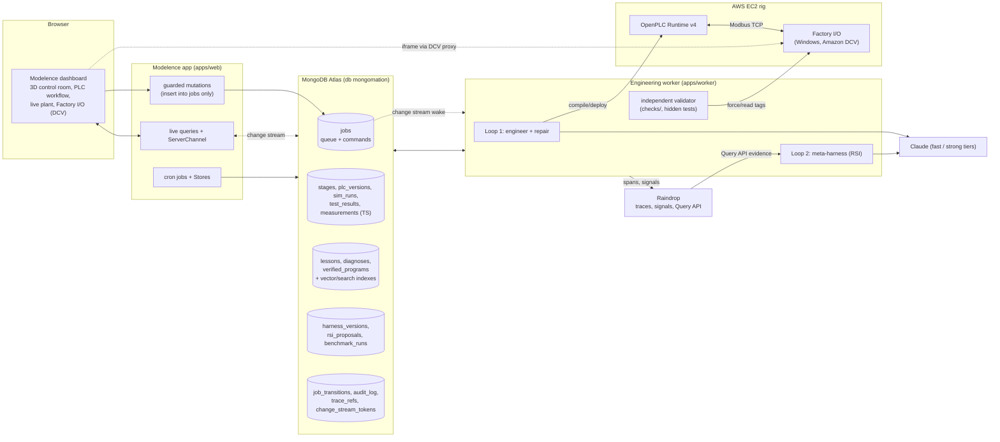
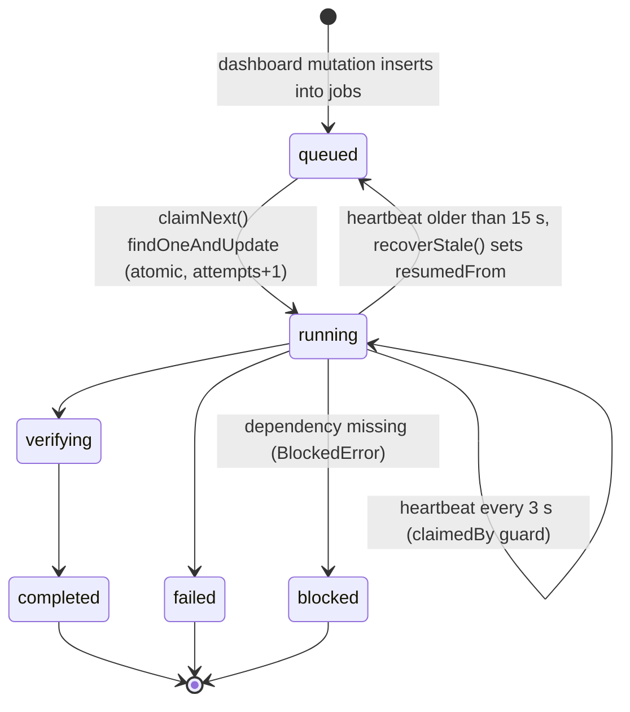
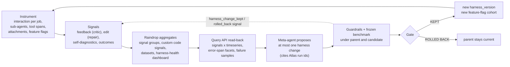
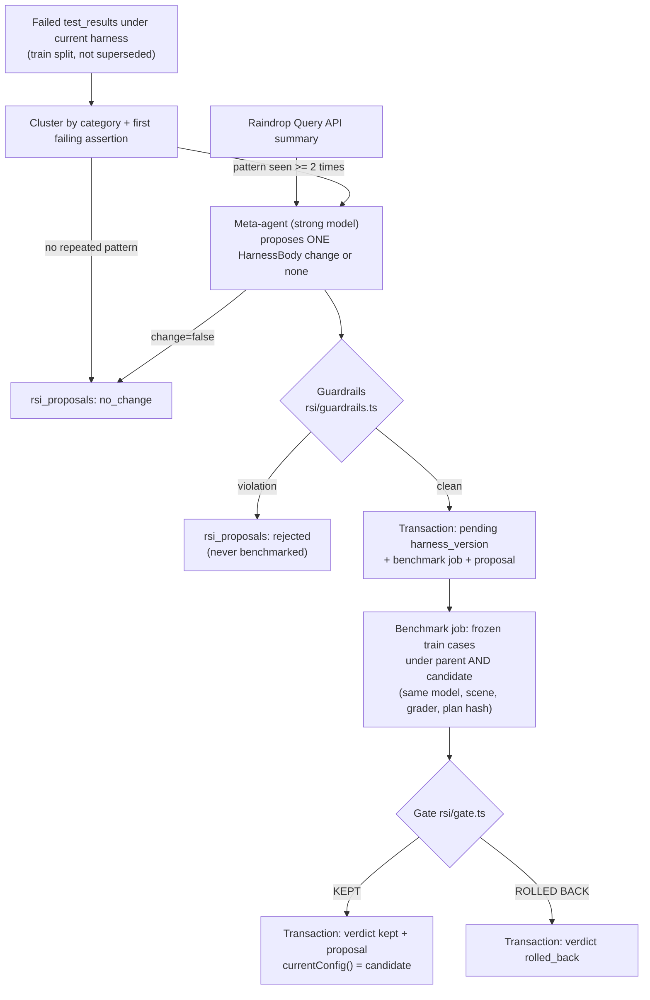

# MongoMation: a self-improving autonomous PLC engineer

> Describe the machine. We engineer the control system. The harness gets smarter.

**TL;DR**
1. **What:** an AI agent turns a plain-English machine spec into an IEC 61131-3 Structured Text PLC program, compiles and deploys it to a real OpenPLC runtime, and tests it against a live Factory I/O plant on AWS EC2.
2. **Why it matters:** nothing the model writes is trusted. An independent grader decides pass/fail from measured plant samples. Failures drive a repair loop, and a second loop improves the *harness itself* behind a guardrailed, benchmark-gated keep/rollback decision.
3. **Result (live Atlas, 2026-10-11):** a custom spec reached **8/8 requirements verified and 14/14 tests passed** (public + hidden) after one repair. 7 projects are fully verified, across 473 graded tests and 60,042 time-series samples.

**Sponsors:**


**Stack:**


Live dashboard (Modelence Cloud): https://mongomation-mv43qiu7n6f-prod.cloud.modelence.app

## Contents

- [For judges: 60-second tour](#for-judges-60-second-tour)
- [Measured numbers](#measured-numbers)
- [Architecture](#architecture)
- [End-to-end pipeline](#end-to-end-pipeline)
- [Job lifecycle](#job-lifecycle)
- [MongoDB Atlas deep dive](#mongodb-atlas-deep-dive)
- [Data model](#data-model)
- [Raindrop deep dive](#raindrop-deep-dive)
- [Self-improvement loop (RSI)](#self-improvement-loop-rsi)
- [Modelence](#modelence)
- [AWS](#aws)
- [Repo map for agents](#repo-map-for-agents)
- [How to run, test and verify](#how-to-run-test-and-verify)
- [Environment variables](#environment-variables)
- [Glossary](#glossary)
- [Status and honest limits](#status-and-honest-limits)
- [Further reading](#further-reading)

---

## For judges: 60-second tour

| Sponsor | Strongest proof point | Open this file |
|---|---|---|
| **MongoDB Atlas** | Atlas is the control plane, not just storage. Jobs are claimed with an atomic `findOneAndUpdate`. Idle workers are woken by a resumable **change stream** (resume token persisted in Atlas). Every pipeline stage is checkpointed, so a `kill -9` mid-job resumes where it stopped (2 jobs in Atlas carry `resumedFrom`). The RSI candidate, its benchmark job and its proposal commit in **one multi-document transaction**. | [`apps/worker/src/harness/jobwatch.ts`](apps/worker/src/harness/jobwatch.ts), [`apps/worker/src/rsi/evolve.ts`](apps/worker/src/rsi/evolve.ts) |
| **MongoDB Atlas (search + Voyage)** | Agent memory uses **hybrid retrieval**: `$vectorSearch` on an Atlas **autoEmbed** index (Voyage `voyage-4`, embedded by Atlas, no key in our code) fused with Atlas Search (`lucene.english`, fuzzy, autocomplete, `$searchMeta` facets) via **`$rankFusion`**. It degrades to `$scoreFusion`, then client RRF, then recency. 6 search/vector indexes are `READY` on the live cluster. | [`apps/worker/src/harness/memory.ts`](apps/worker/src/harness/memory.ts) |
| **Raindrop** | The loop is closed. Every job is one Raindrop interaction tagged with `harness_version` feature flags. Agents are sub-agents, rig steps are tool spans, critic verdicts are `feedback` signals and repairs are `edit` signals. The RSI meta-agent **reads Raindrop back through the Query API** (signal counts, failing spans, failure samples) before it proposes a harness change. | [`apps/worker/src/telemetry/raindrop.ts`](apps/worker/src/telemetry/raindrop.ts), [`apps/worker/src/telemetry/raindrop-query.ts`](apps/worker/src/telemetry/raindrop-query.ts) |
| **Modelence** | The deployed dashboard runs on `startApp` + one `Module`. It has **live queries** fed by one shared Atlas change stream, a `ServerChannel`, 3 cron jobs, 4 Stores, guarded and rate-limited mutations, roles, verified-email auth and `@modelence/ai` failure explanations. | [`apps/web/src/server/mongomation/index.ts`](apps/web/src/server/mongomation/index.ts), [`apps/web/src/server/mongomation/live.ts`](apps/web/src/server/mongomation/live.ts) |
| **AWS** | The plant is real. OpenPLC Runtime v4 and Factory I/O run on EC2, and Factory I/O is streamed into the dashboard through Amazon DCV. S3, CloudWatch, SSM and Secrets Manager modules and a CloudFormation template exist but are flag-gated and **not deployed** (see [AWS](#aws)). | [`apps/web/src/client/components/workflow/tabs/FactoryIoTab.tsx`](apps/web/src/client/components/workflow/tabs/FactoryIoTab.tsx), [`apps/worker/src/aws/index.ts`](apps/worker/src/aws/index.ts) |

---

## Measured numbers

Read-only queries against the live Atlas database `mongomation` and the Raindrop project on **2026-10-11** (about 21:30 UTC). They change as the system runs. `npm run ledger` regenerates an evidence ledger with record ids.

| Metric | Value | Source |
|---|---|---|
| Collections in `mongomation` | 29 (incl. 1 time-series), plus the internal `system.buckets.measurements` | Atlas `listCollections` |
| Jobs | 27 (17 completed, 6 blocked, 2 failed, 1 running, 1 queued) | `jobs` |
| Jobs by type | engineer 13, evolve 4, fault_and_improve 4, benchmark 3, ablation 3 | `jobs` |
| Jobs recovered after a worker crash/stale claim | 2 (`resumedFrom` set) | `jobs` |
| Audited job status transitions | 49 | `job_transitions` |
| Projects | 19 (7 verified, 5 partially verified, 3 blocked, 4 running/abandoned) | `projects` |
| Best custom run | 8/8 requirements verified, 14/14 tests, 2 attempts | `projects`, `sim_runs` |
| Largest fully passing sim run | 19/19 tests | `sim_runs` |
| Graded tests | 473 (333 passed, 58 failed, 82 blocked; 291 public, 182 hidden) | `test_results` |
| Plant samples | 60,042 in 473 time-series buckets | `measurements` |
| Stage checkpoints | 255 (249 done) | `stages` |
| PLC program versions / compiles / deploys | 35 / 63 / 32 | `plc_versions`, `compile_results`, `deployments` |
| Critic diagnoses / repairs | 17 / 16 | `diagnoses`, `repairs` |
| Lessons | 22 (2 active from the lesson writer, 5 candidates, 9 superseded, 6 legacy) | `lessons` |
| Verified programs in program memory | 8 | `verified_programs` |
| Raindrop trace refs joined to Atlas evidence | 455 (374 tool, 68 AI, 13 run) | `trace_refs` |
| Harness versions | 3 (v0 baseline, v1 operator seed, v2 operator restore of v0) | `harness_versions` |
| RSI proposals | 7, all `no_change` | `rsi_proposals` |
| Search / vector indexes `READY` | 6 (`lessons_vec`, `lessons_search`, `diagnoses_vec`, `diagnoses_search`, `verified_programs_vec`, `verified_programs_search`) | `listSearchIndexes` |
| Raindrop events, last 30 days | 463 | Raindrop event count |
| Raindrop signals with hits, last 30 days | 12 (8 instrumented from code, 4 custom code signals defined in Raindrop) | Raindrop signals |
| Raindrop datasets | "MongoMation failing interactions" (26 rows), "MongoMation verified successes" (12 rows) | Raindrop datasets |
| Raindrop dashboard | "MongoMation harness health" (12 panels) | Raindrop dashboards |

---

## Architecture



Design rules (unchanged from day one):
- **No mocked services in demo paths.** A missing dependency shows `BLOCKED` or `DISCONNECTED` with the real error.
- **The model never grades its own code.** The grader is pure and separate ([`checks/src/grader.ts`](checks/src/grader.ts)). `npm run verify:isolation` fails the build if `agents/` or `rsi/` imports the validator or hidden tests ([`scripts/verify-isolation.ts`](scripts/verify-isolation.ts)).
- **No evidence, no verdict.** A requirement without measured evidence is never reported as verified. Missing samples make a test `blocked`, never `passed`.
- **The harness owns the I/O addresses.** The model writes logic only. The I/O block is assembled from the scene's verified address map ([`apps/worker/src/pipeline/st.ts`](apps/worker/src/pipeline/st.ts)).

---

## End-to-end pipeline

**What:** Loop 1 takes a spec to a verified PLC program. **Where:** [`apps/worker/src/pipeline/engineer.ts`](apps/worker/src/pipeline/engineer.ts). **How:** each stage runs through `runStage()` ([`apps/worker/src/harness/stages.ts`](apps/worker/src/harness/stages.ts)), which writes its output to Atlas before marking it done.

| # | Stage | What happens | Atlas writes | Raindrop |
|---|---|---|---|---|
| 1 | `requirements` | LLM extracts structured control requirements from the spec ([`agents/requirements.ts`](apps/worker/src/agents/requirements.ts)) | `stages` | `trackAi` sub-agent `requirements` |
| 2 | `io_design` | LLM binds requirement roles to **real** scene tags, then deterministic checks (tag exists, direction fits) ([`agents/binder.ts`](apps/worker/src/agents/binder.ts)) | `requirements` | self-diagnostic `capability_gap` per unsupported requirement |
| 3 | `state_machine` (optional) | Design + verify a state machine before code (harness flag) | `stages` | sub-agent |
| 4 | `plc_code` | Codegen with retrieved lessons, similar failures and (optionally) verified reference programs ([`agents/codegen.ts`](apps/worker/src/agents/codegen.ts)) | `plc_versions` (versioned, line diff) | attachments: `.st` program + diff |
| 5 | `preflight` | Static lint + local MatIEC compile ([`tools/preflight.ts`](apps/worker/src/tools/preflight.ts)) | `compile_results` | tool span |
| 6 | `compile` | STruC++ bundle uploaded to OpenPLC v4, compiled on device ([`tools/openplc.ts`](apps/worker/src/tools/openplc.ts)) under the Atlas rig lease | `compile_results` | tool span, `plc_compile_failed` signal |
| 7 | `deploy` | Start runtime, then wait until the Modbus link is **proven** by a heartbeat the harness injects into every program ([`tools/linkprobe.ts`](apps/worker/src/tools/linkprobe.ts)) | `deployments` | tool span |
| 8 | `simulate` / `tests` | Public + hidden tests drive sensors through the Factory I/O Web API and sample tags ([`pipeline/validate.ts`](apps/worker/src/pipeline/validate.ts), [`checks/src/runner.ts`](checks/src/runner.ts)) | `sim_runs`, `test_results`, `measurements` | one tool span (and per-test event) per test, `simulator_test_failed` |
| 9 | `diagnosis` | Critic explains failures (hidden failures reach it only as a category) | `diagnoses` | `critic_verdict` feedback signal, `root_cause` self-diagnostic |
| 10 | `repair` | Full rewrite or targeted patch. Escalates to the strong model after N failures (harness routing) | `repairs`, new `plc_versions` | `repair_edit` edit signal |
| 11 | `verification` | Per-requirement verdicts. A fully passing program is written to program memory | `projects`, `verified_programs` | `project_verified` / `project_not_verified` |

The fault path ([`apps/worker/src/pipeline/fault.ts`](apps/worker/src/pipeline/fault.ts), "Inject Fault & Improve Harness") forces a real sensor fault through the Factory I/O Web API, confirms it by reading the tag back, runs the fault tests, repairs, and only then asks the meta-agent for a harness change.

---

## Job lifecycle



Every arrow above is captured from the `jobs` change stream with **pre- and post-images** into `job_transitions` (`from` = pre-image status, `to` = post-image status). The dashboard's evidence timeline shows them next to stage events, public tests and Raindrop trace refs ([`apps/worker/src/db/lineage.ts`](apps/worker/src/db/lineage.ts)).

---

## MongoDB Atlas deep dive

Atlas has seven jobs in MongoMation: control plane, event bus, durability layer, system of record, time-series store, agent memory (with Voyage embeddings via Atlas) and audit log. Each subsection below has the same shape.

### Atlas: durable job queue (control plane)

- **What:** the only interface between the dashboard and the worker. The dashboard inserts `{type, status: "queued"}`, and workers claim, heartbeat and finish jobs.
- **Where:** [`apps/worker/src/harness/jobs.ts`](apps/worker/src/harness/jobs.ts), [`apps/worker/src/main.ts`](apps/worker/src/main.ts), [`apps/web/src/server/mongomation/mutations.ts`](apps/web/src/server/mongomation/mutations.ts), [`apps/worker/src/launcher.ts`](apps/worker/src/launcher.ts)
- **How it works:**
  - `claimNext()` runs `findOneAndUpdate({status:"queued"}, {$set:{status:"running", claimedBy, heartbeatAt}, $inc:{attempts:1}}, {sort:{createdAt:1}})`. One atomic claim, FIFO.
  - `heartbeat()` updates only `{_id, claimedBy: me}`. If it matches 0 documents, the claim was lost.
  - `recoverStale()` re-queues `running`/`verifying` jobs whose `heartbeatAt` is older than 15 s. It uses a compare-and-set on the exact `heartbeatAt` + `claimedBy` it read, so it never steals a live job, and it records `resumedFrom`.
  - "Interrupt Worker" is itself a job (`type: "worker_command"`), consumed with `findOneAndUpdate`. The worker then `exit(137)`s like a crash.
  - Indexes `{status:1, createdAt:1}`, `{type:1, status:1, command:1}` and `{status:1, heartbeatAt:1}` cover the hot queries. `npm run setup:atlas` runs `explain` on them ([`scripts/atlas-explain.ts`](scripts/atlas-explain.ts)).
- **Why it's load-bearing:** without atomic claims, two workers would drive the same PLC. Without the CAS recovery, a crashed job would be stranded or double-run.
- **Status:** live. 27 jobs processed. 2 were recovered after an interrupt and resumed from checkpoints.

### Atlas: change streams and resume tokens (event bus)

- **What:** push-based wakeups and audit, with polling kept only as a safety net.
- **Where:** [`apps/worker/src/harness/jobwatch.ts`](apps/worker/src/harness/jobwatch.ts) (`watchJobs`, `durableWatch`, `watchJobTransitions`, `watchHarnessImmutability`), [`apps/worker/src/harness/lessonwriter.ts`](apps/worker/src/harness/lessonwriter.ts) (`watchLessons`), [`apps/web/src/server/mongomation/live.ts`](apps/web/src/server/mongomation/live.ts)
- **How it works:**
  - `watchJobs` uses a server-side `$match` (inserts, and updates that set `status: "queued"`) plus a `$project`. It fires `jobArrived` / `commandArrived`, and the job loop wakes immediately instead of after its 1.5 s poll.
  - **Resume tokens** are persisted per worker in `change_stream_tokens` (TTL 7 d). A restarted worker replays the inserts it missed. Error codes 286/280/260 (token off the oplog) clear the token, and polling covers the gap.
  - `durableWatch()` is a reusable resumable stream with exponential backoff (1 s to 30 s) that never throws. Four streams use it: job wakeups, job transitions, harness immutability and the lesson writer (`sim_runs` with `fullDocument: "updateLookup"`).
  - The dashboard opens **one** shared change stream over 17 worker collections and fans it out to every Modelence live query and the `mm-events` channel (see [Modelence](#modelence)).
- **Why it's load-bearing:** the "Interrupt / Resume from MongoDB" demo and sub-second dashboard updates depend on it. Without resume tokens, a worker restart silently drops wakeups.
- **Status:** live. `change_stream_tokens` holds 2 tokens and `job_transitions` holds 49 audited transitions.

### Atlas: stage checkpoints and rig lease (durability)

- **What:** "kill it, restart it, nothing lost."
- **Where:** [`apps/worker/src/harness/stages.ts`](apps/worker/src/harness/stages.ts), [`apps/worker/src/harness/riglock.ts`](apps/worker/src/harness/riglock.ts)
- **How it works:**
  - `runStage()` keys each stage by `{projectId, revision, stage, attempt}` (unique index) and stores a sha256 `inputHash`. A rerun with the same input reuses the stored output and logs "reused checkpoint from Atlas".
  - Side-effecting stages (`compile`, `deploy`) include a process `BOOT_ID` in their input, so they are **redone** after a restart (the runtime may hold a different program now). Completed `simulate` evidence is **reused**.
  - A spec change starts a new `revision`. Only stages whose inputs changed rerun.
  - `withRig()` is a lease lock in `rig_locks`: `findOneAndUpdate` with `upsert` where `leaseUntil < now` or `holder == me`, a 20 s lease renewed every ~6.7 s, and release in `finally`. A dead worker's lease simply expires.
- **Why it's load-bearing:** one OpenPLC + one Factory I/O scene is a single physical resource. Interleaved compile/deploy/test from two jobs would produce garbage evidence.
- **Status:** live. 255 stage checkpoints. `rig_locks` holds the single rig lease.

### Atlas: multi-document transactions (self-improvement integrity)

- **What:** ACID transactions around the meta-harness decisions.
- **Where:** [`apps/worker/src/db/index.ts`](apps/worker/src/db/index.ts) (`withTxn`, `withTxnRetry`), [`apps/worker/src/rsi/evolve.ts`](apps/worker/src/rsi/evolve.ts), [`apps/worker/src/harness/config.ts`](apps/worker/src/harness/config.ts)
- **How it works:**
  - **Transaction 1** (`runEvolveRound`) commits together: insert the `pending` harness version (`storeCandidate`), enqueue the `benchmark` job that will judge it, and insert the `rsi_proposals` row linking both. A worker woken by the `jobs` change stream can never see the benchmark job before its candidate exists.
  - **Transaction 2** (`runBenchmarkJob`) commits together: the harness version's verdict (which decides what `currentConfig()` returns, and therefore which harness every later job runs) and the proposal's verdict on the dashboard.
  - Both use `session.withTransaction` with `readConcern: snapshot`, `writeConcern: majority` and `readPreference: primary`. `withTxnRetry` adds an outer retry on `TransientTransactionError` / `UnknownTransactionCommitResult`.
- **Why it's load-bearing:** without them, a crash between writes leaves a `pending` version with no benchmark (never decided), or a dashboard verdict that disagrees with the harness actually in use.
- **Status:** implemented and unit-tested ([`apps/worker/test/mongo.test.ts`](apps/worker/test/mongo.test.ts), [`apps/worker/test/atlas.live.test.ts`](apps/worker/test/atlas.live.test.ts)). Live: all 7 RSI rounds so far ended `no_change` (no failure pattern repeated twice), so Transaction 1 activates on the first round that produces a guardrail-clean proposal.

### Atlas: system of record and `$jsonSchema` validation

- **What:** every spec, requirement binding, program version, compile log, deployment, sim run, test verdict and harness version is a document. Database-side validators enforce the invariants.
- **Where:** [`apps/worker/src/db/schema.ts`](apps/worker/src/db/schema.ts), [`scripts/setup-atlas.ts`](scripts/setup-atlas.ts), [`apps/worker/src/harness/programs.ts`](apps/worker/src/harness/programs.ts) (`programsValidator`)
- **How it works:**
  - `harness_versions` (validationLevel `strict`): `workflow.run_regression_tests` must be `enum: [true]`, `repair_budget` must be 1..5, at most 24 rules of 8..400 characters, and `verdict` must be one of `kept|pending|rolled_back|rejected`. **The server, not the worker, refuses a harness that turns off regression tests.**
  - `jobs` (`moderate`): `type` and `status` enums, `origin`, `command`. `test_results` (`moderate`): `verdict ∈ {passed, failed, blocked}` plus required links to `simRunId`, `projectId` and `harnessVersion`. `rsi_proposals` (`moderate`): `verdict` enum.
  - Before applying `strict`, `ensureValidators()` counts existing violators with `{$nor:[{$jsonSchema}]}` and downgrades to `moderate` if any exist, so legacy documents stay updatable.
  - `verified_programs` gets a `warn` validator (`additionalProperties: false` on the `tests` sub-document, so test definitions can never be stored there).
- **Why it's load-bearing:** the meta-agent proposes harness JSON. Guardrails reject bad proposals in code, and the validator is a second, independent line of defence in the database.
- **Status:** applied on the live cluster. Observed on 2026-10-11: `harness_versions` `strict`, `jobs` / `test_results` / `rsi_proposals` / `verified_programs` `moderate`. The live cluster reports `validationAction: warn`, while `setup:atlas` applies `error` on its next run.

### Atlas: time-series telemetry and window analytics

- **What:** every plant sample measured during a test is stored in an Atlas **time-series collection**, and analytics run inside the aggregation engine.
- **Where:** [`scripts/setup-atlas.ts`](scripts/setup-atlas.ts) (creation), [`apps/worker/src/pipeline/validate.ts`](apps/worker/src/pipeline/validate.ts) (writes), [`apps/web/src/server/mongomation/analytics.ts`](apps/web/src/server/mongomation/analytics.ts) (dashboard), [`apps/worker/src/db/analytics.ts`](apps/worker/src/db/analytics.ts) (worker library)
- **How it works:**
  - `measurements` uses `timeField: ts`, `metaField: meta = {simRunId, testId}` and `granularity: seconds`. Each document is one sample of `values = {tag: bool | number}`. Secondary indexes cover `meta.testId + ts`, `meta.simRunId + ts` and `meta.simRunId + meta.testId + ts`.
  - Dashboard analytics (live query `liveAnalytics`) use `$setWindowFields` + `$shift` (sampling gaps, tag transitions), **`$percentile`** (p50/p95 sampling gap), `$dateTrunc` + **`$densify`** + **`$fill`** (per-second counts with idle seconds as 0), range-window moving averages, and a 3-run rolling public pass rate.
  - Worker library: `signalSeries` (`$derivative`, moving average, edge detection), `densifiedTimeline` (LOCF trend view), `downsample` (`$bucketAuto`), `runSummary` (`$facet` totals / per-test / per-tag duty cycle) and `testTrend` (regression drift across runs).
  - Because the grader is pure, **any stored run can be re-graded from Atlas measurements alone**.
- **Why it's load-bearing:** verdicts are claims about measured behaviour, and the samples are the proof. Hidden tests are excluded from every browser-bound analytics query.
- **Status:** live. 60,042 samples in 473 buckets. [`infra/atlas/online-archive.json`](infra/atlas/online-archive.json) defines Online Archive for samples older than 30 days (M10+, billed; authored, not applied).

### Atlas: agent memory with Voyage vectors, Atlas Search and `$rankFusion`

- **What:** retrieval of verified lessons and similar diagnosed failures that are injected into codegen and repair prompts.
- **Where:** [`apps/worker/src/harness/memory.ts`](apps/worker/src/harness/memory.ts), [`apps/worker/src/harness/search-indexes.ts`](apps/worker/src/harness/search-indexes.ts), [`scripts/setup-atlas.ts`](scripts/setup-atlas.ts) (vector indexes), [`scripts/setup-search.ts`](scripts/setup-search.ts) (lexical indexes, filter fields), [`apps/web/src/server/mongomation/search.ts`](apps/web/src/server/mongomation/search.ts) (dashboard search)
- **How it works:**
  - **Vector side:** `lessons_vec` / `diagnoses_vec` are `vectorSearch` indexes with an **`autoEmbed`** field (`modality: text`, `model: voyage-4`). Atlas embeds documents and queries itself, so the worker passes `query: {text}` and holds no embedding key. `EMBEDDING_MODE=voyage` switches to bring-your-own 1024-d vectors through the Voyage API on the Atlas model endpoint, and `EMBEDDING_MODE=off` uses recency. Filter fields (`active`, `verified` / `split`, `sceneId`) are declared on the index, so `$vectorSearch` **pre-filters**.
  - **Lexical side:** `diagnoses_search` and `lessons_search` use `lucene.english`, `autocomplete` (edgeGram 2..15, diacritic folding), `token` fields for exact filters and facets, and a nested `document` mapping for `causes.cause` / `causes.fix`. Queries are a `compound.should` fuzzy `text` (maxEdits 1) with non-scoring `equals` filters. Long specs are trimmed to 48 distinct informative terms (`lexicalQuery`) so Lucene's clause limit is never hit, and PLC addresses like `%IX0.1` survive.
  - **Fusion:** `SEARCH_FUSION=rank` (default) runs **`$rankFusion`** with `vector` and `lexical` sub-pipelines. `score` tries **`$scoreFusion`** (sigmoid normalisation), then rank. Unknown-stage errors are remembered, and the system falls back to **client-side RRF** (same formula, `1/(60+rank)`), keeping whichever side still answers, then recency.
  - **Rerank:** `SEARCH_RERANK=voyage` re-orders fused candidates with Voyage `rerank-2.5`.
  - All search aggregates pass `readConcern: local` (`SEARCH_READ`), because the client default is majority writes and Atlas rejects `$search` under majority reads. That is why the client sets no global `readConcern` ([`apps/worker/src/db/index.ts`](apps/worker/src/db/index.ts)).
  - **Dashboard:** typo-tolerant failure search with `highlight`, search-as-you-type `autocomplete`, and **`$searchMeta` facets** by scene, fault and split.
  - The harness config controls `lessons_k`, `failures_k` and `retrieve_similar_failures`, so the meta-agent can tune retrieval and the gate measures the effect.
- **Why it's load-bearing:** memory is how a fix learned on one machine reaches the next spec. Pure vector search misses exact PLC terms and addresses, while pure lexical search misses paraphrases. Fusion gets both.
- **Status:** live. Six search/vector indexes are `READY`. Tested in [`apps/worker/test/memory-search.test.ts`](apps/worker/test/memory-search.test.ts).

### Atlas: lessons memory (lesson writer)

- **What:** failures become reusable lessons automatically, from evidence rather than from model opinion.
- **Where:** [`apps/worker/src/harness/lessonwriter.ts`](apps/worker/src/harness/lessonwriter.ts), [`scripts/lessons-backfill.ts`](scripts/lessons-backfill.ts), [`apps/worker/src/harness/memory.ts`](apps/worker/src/harness/memory.ts) (`addLesson`, `verifyLessons` path in `engineer.ts`)
- **How it works:**
  - A `durableWatch` change stream on `sim_runs` fires when a run reaches `status: "done"`. If that run tested a program produced by a **repair**, and tests that failed on the parent program now pass, the fast model writes **one** rule ("when <trigger>, PLC code must <rule>") citing project, public test ids, the failing assertion and the fixing diff.
  - `active` (retrieved) only when the rig re-test passed in full. Otherwise it is a `candidate`, promoted with `updateMany` as soon as a later full run of that same program passes.
  - **Isolation:** hidden tests reach the model only as "a hidden <category> check on R6". Every draft is scanned for hidden test ids, titles and assertion labels, and dropped (or its examples nulled) on a verbatim match.
  - **Dedupe:** `$vectorSearch` similarity ≥ 0.9 or token Jaccard ≥ 0.55 within the same plant. Vector-only merges are confirmed by the model, and merges increment `support` instead of inserting. `consolidate()` is append-only and marks duplicates `merged`.
  - Held-out benchmark runs never write memory.
- **Why it's load-bearing:** without verified lessons, repairs never compound. Without the isolation guard, the memory could leak hidden-test answers into codegen.
- **Status:** opt-in on the worker (`LESSON_WRITER=1`), and backfillable with `npm run lessons:backfill`. Live: 7 lesson-writer lessons (2 active, 5 candidate).

### Atlas: verified program memory

- **What:** every program that passed **all** of its tests on the real rig becomes a retrievable reference for new specs on the same plant.
- **Where:** [`apps/worker/src/harness/programs.ts`](apps/worker/src/harness/programs.ts), [`scripts/memory-backfill.ts`](scripts/memory-backfill.ts), [`scripts/setup-search.ts`](scripts/setup-search.ts)
- **How it works:** `verified_programs` (one document per project, unique `projectId`) stores spec, requirement summary, ST source and test **counts** only. `verified_programs_vec` is autoEmbed with **`voyage-code-4`** on `embedText` (falling back to `voyage-4` if the cluster refuses it) and a `sceneId` filter. `verified_programs_search` is the lexical index. Retrieval reuses `hybridSearch` (`$rankFusion`). The cold/warm outcome is stamped on the `plc_code` stage (`memoryUsed`, `hits`, `retrievalMs`, `retrievalVia`), so the two modes can be compared with a query.
- **Why it's load-bearing:** codegen can adapt a proven program instead of starting cold, and the comparison is measurable rather than anecdotal.
- **Status:** write path live (8 documents). Read path is opt-in (`MEMORY_PROGRAMS=1` or job option `memory: true`).

### Atlas: audit and lifecycle

- **What:** an immutable record of how jobs moved and proof that decided harness versions never change, plus TTL on ephemeral data.
- **Where:** [`apps/worker/src/db/schema.ts`](apps/worker/src/db/schema.ts) (`ensurePrePostImages`, `ensureTtl`), [`apps/worker/src/harness/jobwatch.ts`](apps/worker/src/harness/jobwatch.ts)
- **How it works:**
  - `changeStreamPreAndPostImages` is enabled on `jobs` and `harness_versions`.
  - `watchJobTransitions` (`fullDocumentBeforeChange: whenAvailable`) writes `{jobId, from, to, by, attempts, clusterTime}` to `job_transitions`. `_id` is the change event id, so two workers recording the same event collide on `E11000` and the write stays idempotent.
  - `watchHarnessImmutability` treats `pending → decided` as the only legal update. Any other update, replace or delete of a harness version writes a `harness_immutability_violation` to `audit_log`, with the pre-image verdict.
  - TTL indexes: `events.ts` 30 d, `rig_status.checkedAt` 14 d, `change_stream_tokens.at` 7 d, `job_transitions.at` 30 d (all configurable via env). An existing non-TTL index is converted with `collMod`. Evidence collections never expire.
- **Why it's load-bearing:** the self-improvement claim rests on harness history being append-only. This makes tampering detectable instead of trusted.
- **Status:** live. 49 transitions. `audit_log` is empty (0 violations).

### Atlas: lineage and evidence pipelines

- **What:** harness version lineage and a per-project evidence timeline, computed in Atlas.
- **Where:** [`apps/worker/src/db/lineage.ts`](apps/worker/src/db/lineage.ts), [`apps/web/src/server/mongomation/lineage.ts`](apps/web/src/server/mongomation/lineage.ts), [`apps/worker/src/db/traces.ts`](apps/worker/src/db/traces.ts)
- **How it works:**
  - **`$graphLookup`** walks `harness_versions.parent → version` for ancestors and `version → parent` for descendants with `depthField`. A `$lookup` sub-pipeline attaches public test outcomes per version, and `$sortArray` orders the chain.
  - **`$unionWith`** merges `events`, `job_transitions`, **public** `test_results` and `trace_refs` into one time-ordered stream. Hidden tests are filtered inside the sub-pipeline.
  - `trace_refs` is the join table between Atlas evidence ids and Raindrop event ids. Its multikey index on `evidenceIds` turns "which trace produced this test result?" into one indexed lookup.
- **Why it's load-bearing:** every verdict on the dashboard can be followed to its samples and its Raindrop trace.
- **Status:** live. Exposed as dashboard queries `harnessLineage` and `evidenceTimeline`. 455 trace refs.

### Atlas: consistency and read routing

- **Where:** [`apps/worker/src/db/index.ts`](apps/worker/src/db/index.ts)
- `writeConcern: {w: "majority"}`, `retryWrites` and `retryReads` are client-wide, because engineering state is read by other processes and must survive a failover.
- `analyticsRead` uses `secondaryPreferred` with `maxStalenessSeconds: 90` + majority reads, so dashboard analytics are offloaded from the primary.
- `withCausalSession` / `causalRead` provide read-your-writes helpers. Search runs outside them (requires `local`).
- `trace_refs` writes use `w: 1` on purpose (best effort, never blocks the pipeline).

### Atlas: security (least privilege)

- **Where:** [`docs/SETUP.md`](docs/SETUP.md) §2.1, [`apps/web/src/server/mongomation/atlas.ts`](apps/web/src/server/mongomation/atlas.ts), [`apps/plant-sim/src/guard.js`](apps/plant-sim/src/guard.js)
- Two database users. The worker (`MONGODB_URI`) has `readWrite@mongomation`. The dashboard (`MONGODB_URI_WEB`) has the custom role `mm_web` = `read@mongomation` + **`insert` on `mongomation.jobs` only**, so it cannot update or delete anything.
- The dashboard uses a **separate `MongoClient`** for worker collections, so Modelence's startup index reconciliation never touches the worker's indexes. App-owned data lives in Modelence Stores.
- The plant simulator only reads Atlas (it refuses to arm while a worker job is running) and never logs the URI.
- Rig hosts and IPs are redacted from every stored error (`redactRigHost` in [`engineer.ts`](apps/worker/src/pipeline/engineer.ts)).

### Atlas: control-plane extras (authored, not applied)

[`infra/atlas/`](infra/atlas) holds three Admin-API pieces the driver cannot create, applied with `infra/atlas/apply.sh` (dry run by default):
- **Atlas Stream Processing** `jobStatusMinutely`: `$source` from the `jobs` change stream with pre-images, `$tumblingWindow` 1 min, `$merge` into `job_status_minutely`.
- **Online Archive** for `measurements` older than 30 days, partitioned by `meta.simRunId`, `meta.testId`.
- **Scheduled trigger** `requeue-stale-jobs` (every minute) as a server-side backstop for stale-job recovery.

Status: authored and reviewed. Not applied, because Stream Processing and Online Archive are billed and need M10+.

### MongoDB feature coverage

| Feature | Where | What it does |
|---|---|---|
| `findOneAndUpdate` atomic claim | [`harness/jobs.ts`](apps/worker/src/harness/jobs.ts) | FIFO job claim with `$inc: {attempts}` |
| Compare-and-set recovery | [`harness/jobs.ts`](apps/worker/src/harness/jobs.ts) | Re-queue stale jobs without stealing live ones |
| Lease lock with upsert | [`harness/riglock.ts`](apps/worker/src/harness/riglock.ts) | One job on the physical rig at a time |
| Change streams + server-side `$match` | [`harness/jobwatch.ts`](apps/worker/src/harness/jobwatch.ts) | Instant worker wake on insert / command |
| Resume tokens | [`harness/jobwatch.ts`](apps/worker/src/harness/jobwatch.ts) → `change_stream_tokens` | Replay missed events after restart |
| Pre/post images | [`db/schema.ts`](apps/worker/src/db/schema.ts), [`harness/jobwatch.ts`](apps/worker/src/harness/jobwatch.ts) | `job_transitions` audit, harness immutability audit |
| Multi-document transactions | [`rsi/evolve.ts`](apps/worker/src/rsi/evolve.ts), [`db/index.ts`](apps/worker/src/db/index.ts) | Candidate + benchmark job + proposal; verdict + proposal |
| `$jsonSchema` validators | [`db/schema.ts`](apps/worker/src/db/schema.ts), [`harness/programs.ts`](apps/worker/src/harness/programs.ts) | `run_regression_tests: true` enforced by the server |
| TTL indexes | [`db/schema.ts`](apps/worker/src/db/schema.ts) | Expire events, rig status, tokens, transitions |
| Time-series collection | [`scripts/setup-atlas.ts`](scripts/setup-atlas.ts) | `measurements` (ts / meta / seconds) |
| `$setWindowFields`, `$shift`, `$derivative` | [`db/analytics.ts`](apps/worker/src/db/analytics.ts), [web `analytics.ts`](apps/web/src/server/mongomation/analytics.ts) | Moving averages, edges, rates, rolling pass rate |
| `$densify` + `$fill` (LOCF) | same | Regular-grid trends, idle seconds as 0 |
| `$percentile` | [web `analytics.ts`](apps/web/src/server/mongomation/analytics.ts) | p50 / p95 sampling gap per test |
| `$bucketAuto`, `$facet` | [`db/analytics.ts`](apps/worker/src/db/analytics.ts) | Downsampling, one-call run summary |
| Atlas Vector Search, `autoEmbed` (Voyage `voyage-4`, `voyage-code-4`) | [`scripts/setup-atlas.ts`](scripts/setup-atlas.ts), [`scripts/setup-search.ts`](scripts/setup-search.ts) | Atlas-side embeddings for lessons, diagnoses, programs |
| Vector pre-filters | [`harness/search-indexes.ts`](apps/worker/src/harness/search-indexes.ts) | `active`/`verified`, `split`/`sceneId`, `sceneId` |
| Atlas Search (`lucene.english`, fuzzy, autocomplete, highlight) | [`harness/memory.ts`](apps/worker/src/harness/memory.ts), [web `search.ts`](apps/web/src/server/mongomation/search.ts) | Lexical retrieval + dashboard failure search |
| `$searchMeta` facets | [`harness/memory.ts`](apps/worker/src/harness/memory.ts) | Failure counts by scene / fault / split |
| `$rankFusion` / `$scoreFusion` | [`harness/memory.ts`](apps/worker/src/harness/memory.ts) | Server-side hybrid fusion with graceful fallback |
| Voyage embeddings + rerank API (Atlas model endpoint) | [`harness/memory.ts`](apps/worker/src/harness/memory.ts) | BYO-vector mode and `rerank-2.5` |
| `$graphLookup`, `$lookup` pipeline, `$sortArray` | [`db/lineage.ts`](apps/worker/src/db/lineage.ts) | Harness version lineage with outcomes |
| `$unionWith` | [`db/lineage.ts`](apps/worker/src/db/lineage.ts) | One evidence stream from four collections |
| Multikey index | [`db/schema.ts`](apps/worker/src/db/schema.ts) | `trace_refs.evidenceIds` → Raindrop trace |
| `explain` checks | [`scripts/atlas-explain.ts`](scripts/atlas-explain.ts) | Proves queue queries use an index |
| Read preference + max staleness | [`db/index.ts`](apps/worker/src/db/index.ts) | Analytics on secondaries |
| Causal sessions | [`db/index.ts`](apps/worker/src/db/index.ts) | Read-your-writes helper |
| Custom role (least privilege) | [`docs/SETUP.md`](docs/SETUP.md) | Dashboard can only insert into `jobs` |
| Stream Processing, Online Archive, Triggers | [`infra/atlas/`](infra/atlas) | Authored; not applied (billed / M10+) |

---

## Data model

All collections live in database `mongomation` (env `MONGODB_DB`). "W" = writer, "R" = reader. Worker = [`apps/worker`](apps/worker), Web = [`apps/web`](apps/web) server. Counts are from the live snapshot above.

<details>
<summary><b>Collections reference (29 Atlas collections + 4 Modelence Stores, click to expand)</b></summary>

| Collection | Purpose | Key fields | Indexes | Validator / TTL / TS | W | R |
|---|---|---|---|---|---|---|
| `jobs` | Work queue + worker commands | `type`, `status`, `claimedBy`, `heartbeatAt`, `attempts`, `resumedFrom`, `projectId`, `raindropEventId`, `command` | `status+createdAt`, `projectId+createdAt`, `type+status+command`, `status+heartbeatAt` | `$jsonSchema` moderate; pre/post images | Web (insert), Worker | Worker, Web, plant-sim |
| `workers` | Worker liveness | `host`, `pid`, `heartbeatAt`, `currentJobId` | `heartbeatAt` | none | Worker | Web |
| `projects` | One engineering project | `specText`, `sceneId`, `status`, `harnessVersion`, `verdicts`, `metrics`, `finalPlcVersionId`, `revision`, `specHistory` | `createdAt` | none | Worker | Web, RSI |
| `stages` | Stage checkpoints | `projectId`, `revision`, `stage`, `attempt`, `inputHash`, `status`, `output`, `dependsOn`, `memoryUsed` | unique `projectId+revision+stage+attempt` | none | Worker | Worker, Web |
| `events` | Stage log lines | `projectId`, `jobId`, `stage`, `level`, `message`, `ts` | `projectId+ts`, `jobId+ts` | TTL 30 d on `ts` | Worker | Web |
| `requirements` | Bound requirements + I/O table | `projectId`, `revision`, `requirements`, `io`, `sceneId` | unique `projectId+revision` | none | Worker | Web |
| `plc_versions` | Every program version | `projectId`, `version`, `source`, `sourceHash`, `createdBy`, `diffFromPrevious`, `harnessVersion` | unique `projectId+version`, `sourceHash` | none | Worker | Web, lesson writer |
| `compile_results` | MatIEC preflight + OpenPLC compile | `plcVersionId`, `stage`, `toolchain`, `ok`, `log`, `durationMs` | `plcVersionId+stage` | none | Worker | Web |
| `deployments` | Runtime starts | `plcVersionId`, `status`, `linkUpMs` | `plcVersionId` | none | Worker | Web |
| `sim_runs` | One test-plan execution | `projectId`, `plcVersionId`, `planHash`, `split`, `faultId`, `status`, `passed`, `failed`, `blocked`, `verdicts` | `projectId+startedAt` | none (watched by lesson writer) | Worker | Web, RSI |
| `test_results` | One test verdict | `testId`, `verdict`, `visibility`, `category`, `assertions`, `simRunId`, `harnessVersion`, `traceId`, `superseded` | `simRunId`, `projectId+verdict`, `harnessVersion+verdict` | `$jsonSchema` moderate | Worker | Web (public only), RSI |
| `measurements` | Plant samples | `ts`, `meta.simRunId`, `meta.testId`, `t`, `values` | `meta.simRunId+meta.testId+ts`, `meta.testId+ts`, `meta.simRunId+ts` | **time series** (`ts`/`meta`, seconds) | Worker | Web analytics |
| `fault_injections` | Forced sensor faults | `projectId`, `faultId`, readback | `_id` | none | Worker | Web |
| `diagnoses` | Critic output | `summary`, `text`, `causes`, `lessons`, `split`, `sceneId`, `traceId` | `projectId+createdAt` | `diagnoses_vec`, `diagnoses_search` | Worker | memory, Web search |
| `repairs` | Repair records | `projectId`, `fromVersionId`, `diagnosisId`, `tier`, `traceId` | `_id` | none | Worker | lesson writer |
| `lessons` | Lessons memory | `pattern`, `fix`, `text`, `active`, `verified`, `status`, `sceneId`, `support`, `sources`, `origin` | `active+createdAt` | `lessons_vec`, `lessons_search` | Worker | codegen, meta-agent |
| `verified_programs` | Program memory | `projectId`, `sceneId`, `specText`, `requirementsSummary`, `stSource`, `tests`, `embedText` | unique `projectId`, `sceneId+verifiedAt` | `$jsonSchema` warn; `verified_programs_vec`, `verified_programs_search` | Worker | codegen |
| `harness_versions` | Versioned harness config | `version`, `parent`, `verdict`, `rules`, `context`, `workflow`, `repair`, `routing`, `scores`, `gateNote` | unique `version`, `verdict+version` | `$jsonSchema` **strict**; pre/post images | Worker | Worker, Web |
| `rsi_proposals` | Meta-agent proposals | `change`, `verdict`, `rationale`, `diff`, `guardrailViolations`, `citedRunIds`, `metaTraceId`, `benchmarkJobId` | `createdAt` | `$jsonSchema` moderate | Worker | Web |
| `benchmark_runs` | Per-case rows + summaries | `benchmarkId`, `condition`, `caseId`, `split`, `metrics`, `kind`, `scores`, `manifestHash` | `harnessVersion+caseId+condition` | none | Worker | Web |
| `benchmark_manifests` | Frozen benchmark hash | `hash`, `frozenAt`, `cases` | unique `hash` | none | Worker | Worker |
| `scenes` | Factory I/O scene registry | `id`, `tags`, address map, `verified`, `setup`, `timing` | unique `id` | none | `npm run seed` | Worker, Web |
| `rig_locks` | Rig lease | `holder`, `leaseUntil` | `_id` | none | Worker | Worker |
| `rig_status` | Live tags + health + DCV URL | `tags`, `forced`, `openplc`, `factoryio`, `dcvUrl`, `checkedAt`, `aws` | `_id` | TTL 14 d on `checkedAt` | Worker | Web, plant-sim |
| `trace_refs` | Atlas evidence ↔ Raindrop event | `runId`, `kind`, `name`, `eventId`, `evidenceIds`, `ok` | `runId`, `eventId`, multikey `evidenceIds` | none | Worker | Web, ledger |
| `change_stream_tokens` | Resume tokens | `_id = stream:worker`, `token`, `at` | `_id` | TTL 7 d on `at` | Worker | Worker |
| `job_transitions` | Job status audit | `jobId`, `type`, `from`, `to`, `by`, `attempts`, `clusterTime` | `jobId+at` | TTL 30 d on `at` | Worker (change stream) | Web timeline |
| `audit_log` | Integrity alerts | `kind`, `op`, `version`, `verdictBefore` | `kind+at` | none (kept) | Worker (change stream) | Web |
| `_txn_selftest` | Transaction/live test scratch | `at` | TTL 1 h | pre/post images | tests | tests |
| Modelence Stores: `mmNotes`, `mmPreferences`, `mmOpsAlerts`, `mmOpsDigests` | App-owned data in Modelence's own database | see [`stores.ts`](apps/web/src/server/mongomation/stores.ts) | declared on the Store | Modelence schema | Web | Web |

</details>

---

## Raindrop deep dive

Raindrop is the agent's flight recorder **and** an input to its self-improvement. Telemetry flows out of every model call and rig step, and Raindrop's own aggregation flows back into the meta-agent.

### The closed loop



### Raindrop: instrumentation (interactions, sub-agents, spans)

- **What:** one Raindrop interaction per engineering job, with every model call and rig step nested under it.
- **Where:** [`apps/worker/src/telemetry/raindrop.ts`](apps/worker/src/telemetry/raindrop.ts) (SDK `raindrop-ai@1.0.1`), [`apps/worker/src/telemetry/index.ts`](apps/worker/src/telemetry/index.ts) (interface + Atlas join), [`apps/worker/src/tools/llm.ts`](apps/worker/src/tools/llm.ts), [`apps/worker/src/main.ts`](apps/worker/src/main.ts)
- **How it works:**
  - `begin()` per job (`convoId` = project id). `setUserDetails` identifies the worker with traits for rig and model routing.
  - Every LLM call is its own `trackAi` event with token `usage`, `cost_usd` and `latency_ms`. It is also a **sub-agent** of the job: `interaction.subagent()` records a dispatch span naming the child event id, and `startSpan("agent:<name>")` covers the real call duration. The job trace reads requirements → binder → codegen → critic → repair.
  - `trackTool` spans for preflight, compile, deploy and every simulator test, with real start time, duration, `evidenceIds` (Atlas ids) and `error` on failure. Skipped steps are not errors. Per-test steps also get their own event (`RAINDROP_CLOUD_PER_TEST`).
  - `withSpan("engineering")` puts the whole run in the OTel context, so nested spans parent correctly.
  - `addAttachments`: the generated `.st` program, the diff to the previous version, and the OpenPLC compile log on failure.
  - Every returned event id is written to Atlas `trace_refs` with the evidence ids it produced ([`apps/worker/src/db/traces.ts`](apps/worker/src/db/traces.ts)).
  - Every SDK call is wrapped in `guard()`, so telemetry can never break engineering. Without `RAINDROP_WRITE_KEY`, telemetry is explicitly **disabled** and trace ids are `null` (never invented).
- **Why it's load-bearing:** a single trace shows *why* a program failed: which agent wrote it, which test failed, which repair changed what.
- **Status:** live. 463 events in the last 30 days, 455 trace refs in Atlas.

### Raindrop: crash-safe trace resume

- **Where:** [`apps/worker/src/main.ts`](apps/worker/src/main.ts), [`apps/worker/src/telemetry/raindrop.ts`](apps/worker/src/telemetry/raindrop.ts) (`beginRun` with `resumeEventId`)
- The job's Raindrop event id is persisted on the `jobs` document (`raindropEventId`). When a crashed or stale job is reclaimed, the new process calls `resumeInteraction(eventId)` and sets `resumed: true`, so one job equals one trace even across `kill -9`.
- **Why:** without it, every crash would split a job into orphaned partial traces, and the meta-agent's failure counts would be inflated.

### Raindrop: feature flags (harness-version tagging) and experiments

- **Where:** [`apps/worker/src/telemetry/index.ts`](apps/worker/src/telemetry/index.ts) (`harnessFlags`)
- Every job interaction and every child event carries `harness_version`, `route_requirements`, `route_codegen`, `route_critic`, `route_repair`, `repair_strategy` and `repair_budget` as Raindrop **feature flags**.
- The "MongoMation harness health" dashboard splits verification rate, test pass rate, cost and tokens by `harness_version`, and has an **"Experiment cohorts: harness x repair strategy x codegen route"** panel built on these flags.
- **Why:** a harness change is an experiment. Without flags, Raindrop data cannot say which harness produced which outcome.

### Raindrop: typed signals and self-diagnostics

- **Where:** [`apps/worker/src/pipeline/engineer.ts`](apps/worker/src/pipeline/engineer.ts), [`apps/worker/src/pipeline/validate.ts`](apps/worker/src/pipeline/validate.ts), [`apps/worker/src/rsi/evolve.ts`](apps/worker/src/rsi/evolve.ts), [`apps/worker/src/telemetry/raindrop.ts`](apps/worker/src/telemetry/raindrop.ts)

| Signal (code name) | Raindrop type | Attached to | 30-day hits |
|---|---|---|---|
| `simulator_test_failed` | default, NEGATIVE | the test's tool event | 30 |
| `critic_verdict` | **feedback** (`comment` = critique) | the event that **wrote** the failing program | 5 |
| `repair_edit` | **edit** (`after` = repaired program, diff in properties) | the event whose program was repaired | 5 |
| `project_not_verified` / `project_verified` | default | job event | 5 / 3 |
| `repair_budget_exhausted` | default, NEGATIVE | job event | 3 |
| `plc_compile_failed` | default, NEGATIVE | compile tool event | 0 |
| `agent_call_failed` | default, NEGATIVE | the failed model call | 0 |
| `harness_proposal_rejected` | default, NEGATIVE | meta-agent event | 0 |
| `harness_change_kept` / `harness_change_rolled_back` | default | meta-agent event of the proposal | 0 |
| self-diagnostic `capability_gap` | **Self Diagnostics** | binder event (requirement unsupported on scene) | 1 |
| self-diagnostic `root_cause` | **Self Diagnostics** | critic event (cause and intended fix) | 4 |
| self-diagnostic `refusal` | **Self Diagnostics** | model call that declined | 0 |

Four more **custom code signals** are defined in Raindrop over the same events: "PLC Requirement Violations" (17), "Incorrect PLC I/O Mapping" (6), "Repair Overrides Critic" (5) and "PLC Repair Nonconvergence" (5). A zero means the condition has not occurred in the window, not that the signal is missing.

### Raindrop: Query API read-back into the meta-agent

- **What:** the RSI meta-agent reads Raindrop before proposing anything.
- **Where:** [`apps/worker/src/telemetry/raindrop-query.ts`](apps/worker/src/telemetry/raindrop-query.ts), [`apps/worker/src/rsi/evolve.ts`](apps/worker/src/rsi/evolve.ts) (`collectEvidence`), [`apps/worker/src/rsi/meta.ts`](apps/worker/src/rsi/meta.ts) (`metaUserPrompt`)
- **How it works:** `RaindropQuery` calls `GET /v1/signals`, `/v1/events/count`, `/v1/events/timeseries?interval=day` (per signal), `/v1/events/error-span-facets?span_type=TOOL_CALL` and `/v1/events?signal=` (failure samples with error-span outputs). The result is a 7-day summary: total events, signals ranked by count (negative first on ties, with daily counts), failing spans and up to 12 concrete failure samples. `formatRaindropEvidence` renders it into the meta-agent prompt next to the Atlas failure clusters. The system prompt tells the model to use Raindrop to judge **how widespread** a cluster is and never to cite Raindrop ids as run ids. Guardrails check cited ids against Atlas `sim_runs`.
- **Why it's load-bearing:** Atlas holds the exact evidence for this harness version, and Raindrop holds the cross-run picture. The meta-agent needs both to pick the most widespread cause rather than the most recent one.
- **Status:** live and fail-soft. With no `RAINDROP_QUERY_API_KEY` or on any HTTP error, the prompt says "Raindrop Query API unavailable" and the loop runs on Atlas evidence alone.

### Raindrop: datasets, dashboard and Workshop evals

- **Datasets (regression sets):** "MongoMation failing interactions" (26 rows: failed jobs, fault runs and simulator tests) and "MongoMation verified successes" (12 rows: verified jobs that a harness change must keep green).
- **Dashboard:** "MongoMation harness health", 12 panels (verification rate and test pass rate by harness version, cost per verified project, agent cost/tokens by version, engineering steps runs vs failures, events/day with errors, latest failing interactions, custom-signal hits, experiment cohorts).
- **Workshop evals:** [`scripts/workshop-eval.ts`](scripts/workshop-eval.ts) (`npm run workshop:eval`) lists root job events through the Query API (read-only, no ingest cost) and imports each trace into a local Raindrop Workshop. It scores each run (final compile, simulator pass rate on last attempts, repair budget, verified, cost) per `harness_version`, writes `issue`/`good` annotations, and exits 1 under `WORKSHOP_EVAL_STRICT=1`. `RAINDROP_WORKSHOP=1` mirrors every live event to Workshop (`workshopUrl()`), and [`.mcp.json`](.mcp.json) registers the Workshop MCP for coding agents (self-healing loop described in [`docs/ARCHITECTURE.md`](docs/ARCHITECTURE.md) §7).
- **Status:** the hosted Raindrop Evals suite ([`scripts/raindrop-ablation.eval.ts`](scripts/raindrop-ablation.eval.ts)) is kept but returned 403 on our org, so `npm run raindrop:eval` routes to Workshop evals.

### Raindrop feature coverage

| Feature | Where | What it does |
|---|---|---|
| `begin` / `finish` interactions | [`telemetry/raindrop.ts`](apps/worker/src/telemetry/raindrop.ts) | One trace per job, `convoId` = project |
| `resumeInteraction` | same, [`main.ts`](apps/worker/src/main.ts) | Same trace after a crash / stale reclaim |
| `trackAi` + token usage + cost | same, [`tools/llm.ts`](apps/worker/src/tools/llm.ts) | Every model call as an event |
| `subagent` dispatch + `startSpan` | same | Agents nested under the job |
| `trackTool` spans with errors | same | Compile, deploy, each test |
| `withSpan` | same | OTel parenting of the whole run |
| `addAttachments` | same, [`engineer.ts`](apps/worker/src/pipeline/engineer.ts) | ST program, diff, compile log |
| `setFeatureFlags` | [`telemetry/index.ts`](apps/worker/src/telemetry/index.ts) | Harness version + routing cohorts |
| `setProperties` | [`telemetry/raindrop.ts`](apps/worker/src/telemetry/raindrop.ts) | Status, attempts, resumed |
| `trackSignal` default / `feedback` / `edit` | same, [`engineer.ts`](apps/worker/src/pipeline/engineer.ts) | Typed outcomes on the right event |
| `selfDiagnose` | same | Capability gaps, root causes, refusals |
| `setUserDetails` | same | Worker identity + routing traits |
| `redactPii` (opt-in) | same (`RAINDROP_REDACT_PII=1`) | PII redaction |
| Local Workshop mirror | same (`workshopUrl`) | Local debugger + evals |
| Query API (signals, count, timeseries, error-span facets, events) | [`telemetry/raindrop-query.ts`](apps/worker/src/telemetry/raindrop-query.ts) | Evidence for the meta-agent |
| Custom code signals, datasets, dashboard | Raindrop project (see live numbers) | Regression sets + harness health |
| Workshop evals + MCP | [`scripts/workshop-eval.ts`](scripts/workshop-eval.ts), [`.mcp.json`](.mcp.json) | Per-harness-version scoring |
| Smoke test | [`scripts/raindrop-smoke.ts`](scripts/raindrop-smoke.ts) | `npm run raindrop:smoke` |
| Unit tests with a recording fake client | [`apps/worker/test/raindrop.test.ts`](apps/worker/test/raindrop.test.ts) | SDK contract checks |

---

## Self-improvement loop (RSI)



- **Meta-agent** ([`rsi/meta.ts`](apps/worker/src/rsi/meta.ts)): edits only the harness (rules, context, workflow, repair, routing), never programs, tests or benchmarks. "No change" is a valid and encouraged answer.
- **Guardrails** ([`rsi/guardrails.ts`](apps/worker/src/rsi/guardrails.ts)): Zod schema (unknown fields such as `skip_tests` fail), append-only rules, regex bans on rules that skip or silence checks, declare outcomes, mention hidden tests or the evaluation set, or reach beyond the simulator. No turning off preflight or the state machine once adopted, and the repair budget moves by at most 1. Cited run ids must exist in Atlas as failed runs under the parent.
- **Gate** ([`rsi/gate.ts`](apps/worker/src/rsi/gate.ts)): blocked tests on either side mean "inconclusive" (rolled back). Any hidden safety regression means rolled back. Then requirement satisfaction ±5 %, then first-try compile +10 %, then ≥ 0.5 fewer repairs, then ≥ 20 % cheaper and not > 20 % slower. Otherwise rolled back.
- **Frozen benchmark** ([`specs/benchmark.json`](specs/benchmark.json), 4 train + 2 held-out cases): its sha256 is recorded in `benchmark_manifests`, and a changed file refuses to compare.
- **Ablation** (`npm run ablation`): held-out cases under `bare` (one-shot, no rules, no memory, no preflight, no repairs), `v0` and the current kept harness.
- **Harness seed/restore** ([`harness/seed.ts`](apps/worker/src/harness/seed.ts), `npm run harness:seed` / `harness:restore`): operator-made, append-only versions for demos (live v1 = seed, v2 = restore of v0).

---

## Modelence

- **What:** the production dashboard: a 3D control room landing page, the PLC workflow page (Build · HMI · Program · Verification · Harness · Log), a live plant tab and a Factory I/O (DCV) tab. It is deployed on Modelence Cloud.
- **Where:** [`apps/web/src/server/app.ts`](apps/web/src/server/app.ts), [`apps/web/src/server/mongomation/`](apps/web/src/server/mongomation), [`apps/web/src/client/`](apps/web/src/client)

| Modelence feature | Where | What it does / why it matters |
|---|---|---|
| `startApp` with modules, roles, email, auth hooks | [`app.ts`](apps/web/src/server/app.ts) | Roles `admin` / `operator` synced to Modelence Cloud. Password-reset and verification redirects. Sign-in rate limit (30 / 15 min / IP). Login/signup/verification audit via `logInfo` (ids only). |
| `Module` with `configSchema` | [`mongomation/index.ts`](apps/web/src/server/mongomation/index.ts) | Secret `atlasUri`, `dbName`, `requireVerifiedEmail`, `requireOperatorRole`, `aiProvider` / `aiModel`, set per environment in the Cloud dashboard |
| Queries | [`queries.ts`](apps/web/src/server/mongomation/queries.ts), [`search.ts`](apps/web/src/server/mongomation/search.ts), [`lineage.ts`](apps/web/src/server/mongomation/lineage.ts) | Public read-only reads with hidden-test scrubbing. Atlas Search, lineage and evidence timeline |
| **Live queries** (`LiveData`) over one shared change stream | [`live.ts`](apps/web/src/server/mongomation/live.ts), [`liveQueries.ts`](apps/web/src/server/mongomation/liveQueries.ts) | One Atlas change stream over 17 collections, fanned out to `liveDashboard`, `liveProject`, `liveRsi`, `liveAblation`, `liveAnalytics`, `liveRigAws`, `liveScenes`, with per-query match + throttle + heartbeat. One stream instead of one per subscriber, so a handful of viewers cannot exhaust the pool. |
| `ServerChannel` | [`live.ts`](apps/web/src/server/mongomation/live.ts) | `mm-events` pushes new worker events (scrubbed of hidden test ids) |
| Mutations with guards | [`mutations.ts`](apps/web/src/server/mongomation/mutations.ts), [`guards.ts`](apps/web/src/server/mongomation/guards.ts) | `generate`, `runExample`, `injectFaultAndImprove`, `changeSpec`, `interruptWorker`, `resumeWorker`. Each requires sign-in + verified email (+ role when configured), validates with zod, re-checks preconditions server-side, caps queued jobs per type, and only ever **inserts into `jobs`** |
| Rate limits | [`guards.ts`](apps/web/src/server/mongomation/guards.ts) | Buckets `mm.job` (6/min/user, 60/h/user, 12/min/IP), `mm.note`, `mm.ai` (5/10 min, 40/day), `mm.ops` via `consumeRateLimit` |
| Cron jobs | [`crons.ts`](apps/web/src/server/mongomation/crons.ts) | `rigWatch` (30 s, stale rig heartbeat), `jobWatch` (1 min, stale jobs / silent worker / backlog), `opsDigest` (15 min, 24 h summary). They read Atlas and write only Stores, each wrapped in `startTransaction` telemetry |
| Stores | [`stores.ts`](apps/web/src/server/mongomation/stores.ts) | `mmNotes`, `mmPreferences`, `mmOpsAlerts`, `mmOpsDigests` with schema + indexes reconciled by Modelence |
| `@modelence/ai` | [`notes.ts`](apps/web/src/server/mongomation/notes.ts) | "Explain this failure" via `generateText`, provider/model from module config, saved as an `ai` note, rate-limited |
| Telemetry | [`crons.ts`](apps/web/src/server/mongomation/crons.ts), [`live.ts`](apps/web/src/server/mongomation/live.ts) | `logInfo`, `logError`, `captureError`, `startTransaction` |
| Client session + live hooks | [`client/lib/api.ts`](apps/web/src/client/lib/api.ts), [`router.tsx`](apps/web/src/client/router.tsx) | `useSession`, `modelenceLiveQuery`, guest/private routes |
| Security headers | [`app.ts`](apps/web/src/server/app.ts) | Default CSP `frame-ancestors 'self'` kept, so job buttons cannot be clickjacked |

UI: the 3D control room ([`pages/RoomPage.tsx`](apps/web/src/client/pages/RoomPage.tsx), [`plc3d/plcroom.js`](apps/web/src/client/plc3d/plcroom.js), three.js) shows each PLC cabinet's live state. Clicking a cabinet opens the door, flies the camera to the PLC and dissolves into the workflow page ([`pages/PlcWorkflowPage.tsx`](apps/web/src/client/pages/PlcWorkflowPage.tsx)). The live plant tab ([`PlantTab.tsx`](apps/web/src/client/components/workflow/tabs/PlantTab.tsx)) renders frames from the software-in-the-loop plant ([`apps/plant-sim`](apps/plant-sim)) in 3D.

**Status:** deployed on Modelence Cloud. Locally `npm run dev` in `apps/web`.

---

## AWS

- **What is live:** the rig. OpenPLC Runtime v4 runs on a Linux EC2 instance, and Factory I/O (Windows) runs on EC2. Factory I/O is OpenPLC's Modbus TCP client. The worker reaches both through the team's HTTPS gateway ([`apps/worker/src/tools/connect.ts`](apps/worker/src/tools/connect.ts), [`tools/openplc.ts`](apps/worker/src/tools/openplc.ts), [`tools/factoryio.ts`](apps/worker/src/tools/factoryio.ts)).
- **Amazon DCV:** the Factory I/O desktop is streamed into the dashboard's "Factory I/O (live)" tab ([`FactoryIoTab.tsx`](apps/web/src/client/components/workflow/tabs/FactoryIoTab.tsx)). The DCV URL comes from `rig_status.dcvUrl` in Atlas, never hard-coded. A local proxy ([`apps/web/scripts/dcv-proxy.mjs`](apps/web/scripts/dcv-proxy.mjs)) makes the self-signed, `X-Frame-Options: DENY` DCV client frameable on localhost and never logs the upstream.
- **SSM:** the plant simulator reaches OpenPLC's Modbus port through an SSM port-forwarding session ([`apps/plant-sim/README.md`](apps/plant-sim/README.md)).
- **Written, flag-gated, not deployed:** [`apps/worker/src/aws/`](apps/worker/src/aws). These are S3 run artifacts with presigned links, CloudWatch custom metrics (low-cardinality dimensions) and Logs, SSM `GetParameter` for the OpenPLC password and Run Command rig health probes, Secrets Manager env fill, and EC2 start/stop for cost control ([`scripts/rig-power.ts`](scripts/rig-power.ts)). [`infra/aws/template.ts`](infra/aws/template.ts) renders a CloudFormation stack (private SSE-S3 bucket, log groups, alarms, dashboard, SSM document, EventBridge schedules disabled by default, least-privilege worker IAM policy). Every feature is off unless its `MM_AWS_*` flag is set, and no `MM_AWS_*` flag is set in this deployment, so this code is **dormant**. It activates when the flags and credentials are provided. Unit-tested in [`apps/worker/test/aws.test.ts`](apps/worker/test/aws.test.ts).

---

## Repo map for agents

```
apps/
  worker/            engineering worker (TypeScript, tsx)
    src/main.ts        ENTRY: job loop, rig monitor, change-stream watchers
    src/launcher.ts    ENTRY: supervisor for the Interrupt / Resume demo
    src/agents/        LLM agents: requirements, binder, codegen (+ state machine, critic, repair)
    src/pipeline/      engineer.ts (Loop 1), fault.ts, validate.ts (only importer of checks/), st.ts (I/O block)
    src/harness/       jobs, jobwatch (change streams), stages (checkpoints), riglock, config (versions),
                       memory (hybrid search), search-indexes, programs, lessonwriter, seed
    src/rsi/           evolve (Loop 2), meta (meta-agent), guardrails, gate
    src/telemetry/     Raindrop SDK sink, Query API client, Telemetry interface
    src/db/            client + transactions, schema (validators/TTL/pre-post images), analytics, lineage, traces
    src/tools/         openplc, factoryio, llm, preflight (MatIEC), linkprobe, connect, rig
    src/aws/           S3, CloudWatch, SSM, Secrets Manager, EC2 (flag-gated)
    test/              node:test suites (mongo, rsi, raindrop, memory-search, lessonwriter, programs, aws, ...)
  web/               Modelence dashboard
    src/server/app.ts  ENTRY: startApp
    src/server/mongomation/  module: queries, live queries, mutations, guards, crons, stores, search, lineage
    src/client/        React UI: pages/ (RoomPage, PlcWorkflowPage), plc3d/ (three.js), components/workflow/tabs/
    scripts/           dcv-proxy.mjs, dev-local.sh
  plant-sim/         software-in-the-loop plant (Modbus TCP to OpenPLC, WebSocket :5195)
    src/server.js      ENTRY
packages/types/      shared contracts (scene, requirements, harness config, tests) with zod
checks/              independent validator: pure grader, plan, runner, templates, HIDDEN regression tests
harness/v0.json      baseline harness
scenes/              Factory I/O scene registry (address map, faults, setup, timing)
specs/               examples.json (Run Example), benchmark.json (frozen: 4 train, 2 held-out)
scripts/             setup-atlas, setup-search, seed, evolve, ledger, workshop-eval, rig smoke/health/power, ...
infra/atlas/         Stream Processing, Online Archive, scheduled trigger (authored, not applied)
infra/aws/           CloudFormation template + deploy script (not deployed)
docs/                ARCHITECTURE, SETUP, INTEGRATION_CONTRACT, DEMO_RUNBOOK, SUBMISSION, research/
```

Invariants an agent must keep (see [`AGENTS.md`](AGENTS.md)): never import `checks/` or `hidden/` from `agents/` or `rsi/`. Never fall back to a mocked rig or model. The dashboard writes only to `jobs`. Harness versions are append-only.

---

## How to run, test and verify

```bash
# root workspace (worker, checks, types, scripts); Node >= 22.13
npm install
cp .env.example .env            # fill in values (names listed below)
npm test                        # node --test over checks/test and apps/worker/test
npm run typecheck               # tsc for types, checks, worker, scripts
npm run verify:isolation        # agents/ and rsi/ cannot reach the validator or hidden tests
npm run green                   # live check: atlas, claude, raindrop, preflight, openplc, factoryio

# Atlas setup (idempotent)
npm run setup:atlas             # collections, indexes, time series, TTL, validators, pre/post images, vector indexes, explain
npm run setup:search -- --wait  # Atlas Search indexes, vector filter fields, verified_programs
npm run seed                    # harness v0 + scene registry

# run
npm run worker                  # the engineering worker
npm run launcher                # worker under the Interrupt/Resume supervisor
npm run example                 # enqueue a Run Example job
npm run fault                   # inject a fault and improve
npm run evolve                  # one RSI round (benchmark / ablation: npm run benchmark, npm run ablation)
npm run ledger                  # evidence ledger from Atlas
npm run rig:smoke               # rig connectivity

# dashboard (Modelence)
cd apps/web && npm install && npm run dev

# software-in-the-loop plant
cd apps/plant-sim && npm install && npm start
```

<details>
<summary><b>All root npm scripts</b></summary>

| Script | Purpose |
|---|---|
| `typecheck`, `test`, `verify:isolation` | Static checks, unit tests, isolation check |
| `green` | Live dependency check |
| `setup:atlas`, `setup:search`, `seed` | Atlas schema, search indexes, baseline data |
| `memory:backfill`, `lessons:backfill` | Backfill `verified_programs` / lessons from past runs |
| `preflight` | Local MatIEC compile of an ST file |
| `worker`, `launcher` | Run the worker (plain / supervised) |
| `example`, `fault` | Enqueue a Run Example / fault-and-improve job |
| `harness:seed`, `harness:restore` | Operator harness versions (append-only) |
| `evolve`, `benchmark`, `ablation` | RSI round, gate benchmark, held-out ablation |
| `rig:smoke` | Rig smoke test |
| `ledger`, `export` | Evidence ledger, project export |
| `probe` | Generate a scene probe program |
| `raindrop:smoke`, `raindrop:eval`, `workshop:start`, `workshop:eval` | Raindrop smoke test, Workshop evals |

</details>

---

## Environment variables

Names only. Values live in `.env` / `.env.rig` (never committed).

| Area | Variables |
|---|---|
| Atlas | `MONGODB_URI` (worker user), `MONGODB_URI_WEB` (dashboard user), `MONGODB_DB`, `EVENTS_TTL_DAYS`, `RIG_STATUS_TTL_DAYS`, `JOB_TRANSITIONS_TTL_DAYS` |
| Memory / search | `EMBEDDING_MODE` (`auto`/`voyage`/`off`), `EMBEDDING_MODEL`, `EMBEDDING_DIMS`, `VOYAGE_API_KEY`, `VOYAGE_BASE_URL`, `SEARCH_FUSION` (`rank`/`score`/`client`/`vector`), `SEARCH_RERANK`, `RERANK_MODEL`, `PROGRAMS_EMBEDDING_MODEL`, `MEMORY_PROGRAMS`, `LESSON_WRITER` |
| Models | `ANTHROPIC_API_KEY`, `MODEL_STRONG`, `MODEL_FAST` |
| Raindrop | `RAINDROP_WRITE_KEY`, `RAINDROP_PROJECT_ID`, `RAINDROP_QUERY_API_KEY`, `RAINDROP_QUERY_URL`, `RAINDROP_CLOUD_PER_TEST`, `RAINDROP_WORKSHOP`, `RAINDROP_LOCAL_DEBUGGER`, `RAINDROP_REDACT_PII`, `RAINDROP_DEBUG`, `WORKSHOP_EVAL_STRICT` |
| Rig | `RIG_ID`, `RIG_INSTANCE`, `RIG_REGION`, `RIG_FIO_HOST`, `SCENE_ID`, `DCV_URL`, `OPENPLC_URL`, `OPENPLC_FLAVOR`, `OPENPLC_USER`, `OPENPLC_PASSWORD`, `OPENPLC_PASSWORD_SSM_PARAM`, `OPENPLC_BUILDER`, `FACTORYIO_URL`, `FACTORYIO_HOST_HEADER`, `FACTORYIO_RELINK_MS`, `FACTORYIO_LINK_TIMEOUT_MS`, `TEAM_API_KEY`, `ALLOW_NO_RIG`, `RIG_POLL_MS`, `RIG_HEARTBEAT_MS`, `WORKER_ID` |
| Preflight | `IEC2C_PATH`, `IEC_LIB`, `OPENPLC_C_LIB` |
| AWS (all off by default) | `MM_AWS_REGION`, `MM_AWS_ARTIFACTS_BUCKET`, `MM_AWS_ARTIFACTS_PREFIX`, `MM_AWS_PRESIGN_TTL_S`, `MM_AWS_METRICS`, `MM_AWS_METRICS_NAMESPACE`, `MM_AWS_LOG_GROUP`, `MM_AWS_SSM_SECRETS`, `MM_AWS_SECRETS_ID`, `MM_AWS_RIG_HEALTH`, `MM_AWS_RIG_HEALTH_MS`, `RIG_FIO_INSTANCE` |
| Plant sim | `PLC_MODBUS_HOST`, `PLC_MODBUS_PORT`, `PLC_MODBUS_UNIT`, `PLANT_SIM_PORT`, `PLANT_SIM_AUTO` |

---

## Glossary

| Term | Meaning |
|---|---|
| **Harness** | Everything around the model that does the engineering: rules, retrieved context, workflow (state machine, preflight, repair budget), repair strategy and model routing. Stored as versioned JSON in `harness_versions` ([`harness/v0.json`](harness/v0.json)). |
| **Harness version** | An immutable harness config with a `parent`. "Current" = newest version with verdict `kept`. |
| **Kept / rolled back / rejected / pending** | Gate verdicts. **Kept**: the candidate measurably beat its parent on the frozen benchmark. **Rolled back**: it did not, or evidence was blocked. **Rejected**: guardrails refused it before any benchmark. **Pending**: awaiting its benchmark job. |
| **No change** | A meta-agent round that found no repeated failure pattern, or chose not to change anything. |
| **RSI** | Recursive self-improvement: Loop 2, which improves the harness, never the programs directly. |
| **Lessons** | Short "when X, PLC code must Y" rules learned from repairs that fixed failing tests on the rig. Only `active` + `verified` lessons are retrieved. |
| **Verified program memory** | Programs that passed every test on the rig, retrievable as references for new specs on the same plant. |
| **Public tests** | Acceptance tests whose titles the agents see. |
| **Hidden tests** | Regression and safety tests probing the same requirement from another angle ([`checks/src/hidden/regression.ts`](checks/src/hidden/regression.ts)). Never shown to agents, the critic, the meta-agent, retrieval or the browser. |
| **Blocked** | No (or not enough) measured evidence. Never counted as passed. Blocks a job instead of triggering a repair. |
| **Rig** | One OpenPLC runtime + one Factory I/O scene on AWS EC2, guarded by the Atlas lease in `rig_locks`. |
| **Scene** | A Factory I/O plant (here "Sorting by Height (Basic)") with its verified tag/address map, faults, setup steps and timing ([`scenes/`](scenes)). |
| **Split (train / held-out)** | Benchmark partition. The gate uses train cases. The ablation uses held-out cases, which never write memory. |
| **Ablation** | Held-out comparison of `bare` (one-shot), `v0` and the current harness. |
| **Stage / checkpoint** | One pipeline step whose output is stored in `stages` before it is marked done. |
| **CAB** | A PLC cabinet in the 3D control room. `/plc/:cab` opens that cabinet's workflow page. |
| **DCV** | Amazon DCV, the remote-display protocol streaming the Factory I/O desktop. |
| **Heartbeat (link)** | A counter the harness appends to every program so the deploy stage can prove the Modbus link is up before any test runs. |
| **ST** | IEC 61131-3 Structured Text, the PLC language generated here. |
| **Trace ref** | Row in `trace_refs` linking an Atlas evidence id to a Raindrop event id. |

---

## Status and honest limits

Snapshot 2026-10-11.

- **Proven live:** the full engineering loop on the real rig (7 verified projects, best custom run 8/8 requirements and 14/14 tests). Crash/resume from Atlas (2 recovered jobs). Change-stream wakeups and transition audit (49 transitions). Hybrid search indexes `READY`. Lesson writer and program memory writes. Raindrop tracing, typed signals, datasets and dashboard.
- **Mechanism built, outcome not yet measured:** the meta-harness has run 7 rounds, all `no_change`. No failure pattern under the current harness repeated twice. No harness version has been *earned* through the gate yet (v1 and v2 are operator seed/restore versions), so the self-improvement claim is a working, guarded mechanism, not a measured gain. The ablation summary row is not yet recorded.
- **Authored, not applied:** Atlas Stream Processing, Online Archive and scheduled trigger (billed / M10+). AWS S3, CloudWatch, SSM and Secrets Manager modules and the CloudFormation stack (flag-gated, no `MM_AWS_*` flags set).
- **Raindrop:** hosted Evals returned 403 on our org, so evals run in Raindrop Workshop.
- **Scope:** one scene, one rig, one PLC vendor. Each deploy waits for Factory I/O's Modbus relink (measured 6.5 s to over 75 s), which limits runs per day.
- **Code push in progress:** this README describes the code that produced the numbers above. A few modules it links to were still being committed when it was written: `apps/worker/src/harness/lessonwriter.ts`, `apps/worker/src/harness/programs.ts`, `apps/worker/src/harness/seed.ts`, `apps/plant-sim/`, `apps/web/scripts/dcv-proxy.mjs` and the `FactoryIoTab` / `PlantTab` dashboard tabs. If one of those links does not resolve yet, it lands with the next push.
- **Validators:** the live cluster currently reports `validationAction: warn`, and `npm run setup:atlas` re-applies `error`.

---

## Further reading

- [`docs/ARCHITECTURE.md`](docs/ARCHITECTURE.md): architecture and Raindrop Workshop details
- [`docs/SETUP.md`](docs/SETUP.md): setup, least-privilege users, preflight compiler
- [`docs/INTEGRATION_CONTRACT.md`](docs/INTEGRATION_CONTRACT.md): AWS rig contract
- [`docs/DEMO_RUNBOOK.md`](docs/DEMO_RUNBOOK.md): demo steps
- [`docs/SUBMISSION.md`](docs/SUBMISSION.md): hackathon submission
- [`docs/research/`](docs/research): verified API notes (OpenPLC v4/v3, Factory I/O, MongoDB, Raindrop, Modelence)
- [`AGENTS.md`](AGENTS.md): rules for coding agents
