# MongoMation

**Describe a machine in plain English. An AI agent writes the PLC program, deploys it to a real OpenPLC runtime, tests it on a live Factory I/O plant, and repairs it until every requirement is verified.**


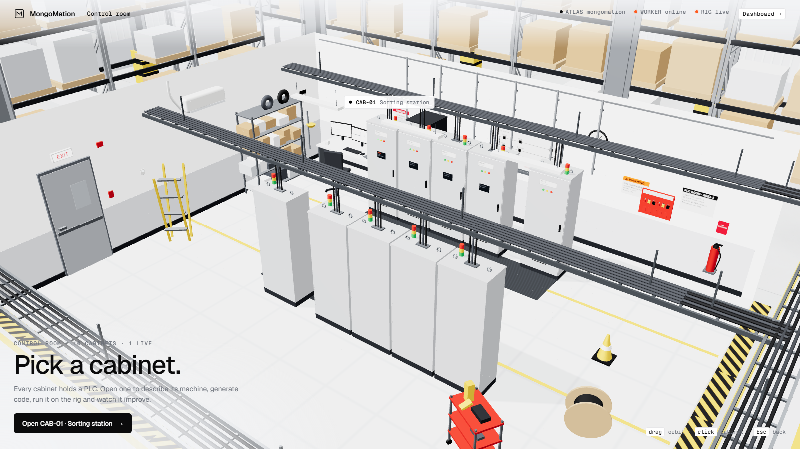

**What it does**
- **Spec to program.** Claude turns a plain-English spec into IEC 61131-3 Structured Text. The harness, not the model, writes every I/O address from the plant's verified map.
- **Real plant, real verdicts.** The program is compiled and run on OpenPLC Runtime v4 on AWS EC2, driving a Factory I/O plant. A pure grader decides pass/fail from measured samples, including hidden tests the model never sees.
- **Self-repair.** Failures go to a critic and a repair agent. The fixed program is re-deployed and re-tested on the rig.
- **Memory and self-improvement.** MongoDB Atlas stores every version, sample and verdict, recalls proven programs and lessons, and backs a meta-agent that may change the harness itself behind guardrails and a benchmark gate.

**Results** (read-only queries against Atlas, 2026-10-11)

| Run | Requirements | Tests (hidden) | Self-repairs | Time | Model cost |
|---|---|---|---|---|---|
| Best custom spec, [walkthrough below](#what-the-agent-did-one-real-run) | **8/8 verified** | **14/14** (5 hidden) | 1 | 5 m 12 s | $0.12 |
| Largest fully passing run (cold, first try) | all verified | **25/25** | 0 | 4 m 27 s | $0.07 |
| Same spec again, exact-spec recall from Atlas | `verified-by-reuse` (not re-tested) | n/a | 0 | about 1 s | $0.00 |
| **Totals in Atlas** | 26 projects, 11 rig-verified | 614 graded test results (464 passed) | 20 repairs | 82,529 plant samples | 644 Raindrop trace refs |

Time is job start to verified (`jobs.startedAt` → `finishedAt`). Cost is the summed Claude cost recorded for the job.

Self-improvement, honestly: the meta-agent has made 9 proposals. 7 were "no change" and 2 were rejected by the guardrails (a proposed rule exceeded the 400-character schema limit; the meta-agent prompt now states the limit, and no round has run since). **No harness change has been kept by the gate yet.**

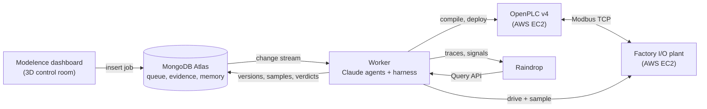

**Quick links:** [Live dashboard](https://mongomation-mv43qiu7n6f-prod.cloud.modelence.app) · [One real run](#what-the-agent-did-one-real-run) · [What the humans decided](#what-the-humans-decided) · [MongoDB Atlas](#mongodb-atlas-deep-dive) · [Raindrop](#raindrop-deep-dive) · [Try it](#try-it) · [For AI agents](#for-ai-agents) · [Honest limits](#status-and-honest-limits)

---

## Contents

- [Try it](#try-it)
- [For AI agents](#for-ai-agents)
- [What the agent did: one real run](#what-the-agent-did-one-real-run)
- [What the humans decided](#what-the-humans-decided)
- [Screens](#screens)
- [How it works](#how-it-works)
- [MongoDB Atlas deep dive](#mongodb-atlas-deep-dive)
- [Raindrop deep dive](#raindrop-deep-dive)
- [Self-improvement loop (RSI)](#self-improvement-loop-rsi)
- [Modelence](#modelence)
- [AWS](#aws)
- [Repo map](#repo-map)
- [How to run, test and verify](#how-to-run-test-and-verify)
- [Environment variables](#environment-variables)
- [Glossary](#glossary)
- [Status and honest limits](#status-and-honest-limits)
- [Further reading](#further-reading)

---

## Try it

1. **Look at real runs (no setup).** Open the [live dashboard](https://mongomation-mv43qiu7n6f-prod.cloud.modelence.app), click cabinet **CAB-01 · Sorting station**, and browse the **Build**, **Program**, **Verification** and **Harness** tabs. Every value is read from Atlas.
2. **Run the code checks locally (no keys).**
   ```bash
   npm install
   npm test && npm run typecheck && npm run verify:isolation
   ```
3. **Run the full loop.** This needs your own Atlas cluster, an Anthropic key, optionally Raindrop, and an OpenPLC v4 + Factory I/O rig. Follow [`docs/SETUP.md`](docs/SETUP.md), then `npm run worker` and click **Run Example** in the dashboard (or `npm run example`). Without a rig, jobs stop at deploy with status `BLOCKED` and the real error. There is no mock mode.

---

## For AI agents

Start with [`AGENTS.md`](AGENTS.md) (rules you must keep), then [`docs/ARCHITECTURE.md`](docs/ARCHITECTURE.md).

| Need | Where |
|---|---|
| Worker entry point | [`apps/worker/src/main.ts`](apps/worker/src/main.ts) (job loop), [`apps/worker/src/launcher.ts`](apps/worker/src/launcher.ts) (supervisor for Interrupt/Resume) |
| Engineering loop (Loop 1) | [`apps/worker/src/pipeline/engineer.ts`](apps/worker/src/pipeline/engineer.ts) |
| Harness self-improvement (Loop 2) | [`apps/worker/src/rsi/evolve.ts`](apps/worker/src/rsi/evolve.ts), [`guardrails.ts`](apps/worker/src/rsi/guardrails.ts), [`gate.ts`](apps/worker/src/rsi/gate.ts) |
| Grader and hidden tests | [`checks/src/grader.ts`](checks/src/grader.ts), [`checks/src/hidden/`](checks/src/hidden) (never import from agents) |
| Shared types (zod) | [`packages/types/src/index.ts`](packages/types/src/index.ts) |
| Dashboard entry point | [`apps/web/src/server/app.ts`](apps/web/src/server/app.ts) (server), [`apps/web/src/client/`](apps/web/src/client) (React) |
| Atlas schema, indexes, validators | [`scripts/setup-atlas.ts`](scripts/setup-atlas.ts), [`scripts/setup-search.ts`](scripts/setup-search.ts), [`apps/worker/src/db/schema.ts`](apps/worker/src/db/schema.ts) |

```bash
npm install                 # Node >= 22.13, root workspace (worker, checks, types, scripts)
npm run typecheck           # tsc over types, checks, worker, scripts
npm test                    # node --test: checks/test + apps/worker/test (test doubles only)
npm run verify:isolation    # fails if agents/ or rsi/ can reach the validator or hidden tests
npm run green               # live dependency check (needs .env)
npm run worker              # run the engineering worker (needs .env + rig)
cd apps/web && npm install && npm run dev   # dashboard (separate package)
```

Env var names (values live in the gitignored `.env`): `MONGODB_URI`, `MONGODB_URI_WEB`, `MONGODB_DB`, `ANTHROPIC_API_KEY`, `MODEL_STRONG`, `MODEL_FAST`, `RAINDROP_WRITE_KEY`, `RAINDROP_QUERY_API_KEY`, `OPENPLC_URL`, `OPENPLC_USER`, `OPENPLC_PASSWORD`, `FACTORYIO_URL`, `SCENE_ID`. Full list: [Environment variables](#environment-variables) and [`.env.example`](.env.example).

---

## What the agent did: one real run

Project `6acbfdb92d832090aa0f0b42`, 2026-10-11, harness v0, scene "Sorting by Height (Basic)". Everything below is copied from Atlas (`jobs`, `requirements`, `plc_versions`, `test_results`, `diagnoses`, `repairs`) and the job's Raindrop trace.

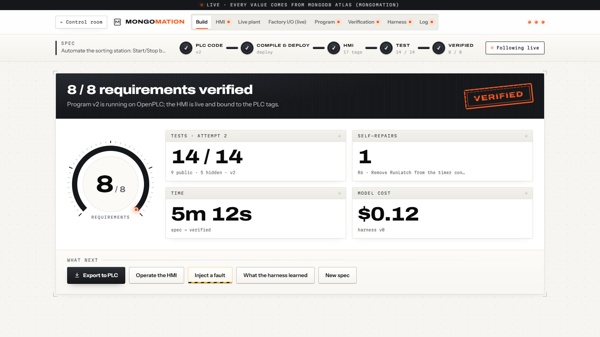

### 1. The spec (typed by a human)

> Automate the sorting station: Start/Stop buttons run the line (Stop always wins, Emergency stop stops everything). Send tall boxes (high sensor) to the right lane and short boxes to the left lane using the chain transfer. If the left exit eye stays blocked for more than 3 seconds, stop the left conveyor and light the Reset light as a fault lamp until Reset is pressed with the eye clear.

The requirements agent extracted 8 requirements (R1 start/stop, R2 E-stop, R3 sorting, R4 3 s jam timeout, R5 fault latch, R6 reset only with the eye clear, R7 fault lamp, R8 no auto-restart). The binder mapped each role to a real scene tag, for example R4 `sensor` → `At left exit`, `actuator` → `Conveyor left`.

### 2. The generated Structured Text (v1, excerpt)

The `VAR ... AT %QX...` block is written by the harness from the verified I/O map. The model wrote only the logic:

```iecst
  StartEdge(CLK := I_Start);
  LeftBlocked := NOT I_AtLeftExit;
  StopPressed := (NOT I_Stop) OR (NOT I_EmergencyStop);

  (* Jam timer only runs while line is running *)
  JamTimer(IN := LeftBlocked AND RunLatch AND NOT JamFault, PT := T#3000ms);

  IF JamTimer.Q THEN
    JamFault := TRUE;
  ELSIF JamFault AND I_Reset AND NOT LeftBlocked AND I_EmergencyStop THEN
    JamFault := FALSE;
  END_IF;

  IF StopPressed OR JamFault THEN
    RunLatch := FALSE;
  ELSIF StartEdge.Q THEN
    RunLatch := TRUE;
  END_IF;

  Enable := RunLatch AND NOT JamFault AND NOT StopPressed;
  Q_ConveyorLeft := Enable;
  Q_TransfRight := Enable AND I_HighSensor;
  Q_ResetLight := JamFault;
```

### 3. Tests on the real plant

Each test forces inputs through the Factory I/O Web API, samples the plant's tags, and is graded by [`checks/src/grader.ts`](checks/src/grader.ts). Hidden tests probe the same requirement from another angle. Their definitions live in [`checks/src/hidden/`](checks/src/hidden) and never reach a prompt, the critic, retrieval or the browser.

| Test | Req | Visibility | Attempt 1 (v1) | Attempt 2 (v2) |
|---|---|---|---|---|
| `R1-start` Pressing Start runs Conveyor left | R1 | public | passed | passed |
| `R1-stop` Pressing Stop stops Conveyor left | R1 | public | passed | passed |
| `H-R1-stop-dominates` Stop dominates a simultaneous start | R1 | hidden | passed | passed |
| `H-R1-no-motion-at-rest` No motion without a start command | R1 | hidden | passed | passed |
| `R2-estop` Emergency stop de-energizes Conveyor left | R2 | public | passed | passed |
| `H-R2-estop-held` Start is ignored while the E-stop is held | R2 | hidden | passed | passed |
| `R3-divert` A tall part is diverted by Transf. right | R3 | public | passed | passed |
| `R4-jam` Eye blocked > 3000 ms stops the conveyor and lights Reset light | R4 | public | passed | passed |
| `H-R4-no-false-trip` A normal transit does not trip the fault | R4 | hidden | passed | passed |
| `R5-latch` Reset light stays latched until Reset | R5 | public | passed (after 1 blocked sample, re-run) | passed |
| `H-R5-start-without-reset` Start does not bypass a latched fault | R5 | hidden | passed | passed |
| `R6-guard` Reset does not clear the fault while the cause is present | R6 | public | **failed** | passed |
| `R7-fault-light` Reset light on during the fault, off after a valid Reset | R7 | public | passed | passed |
| `R8-restart` After a reset the conveyor waits for Start | R8 | public | passed | passed |
| **Total** | | 9 public, 5 hidden | **13/14** | **14/14** |

The grader's message for the failure: `Reset light never reached true within 4500 ms (measured false at +4474 ms)`.

### 4. Diagnosis and self-repair (R6)

The critic (`claude-opus-5-5`) read the measured failure and concluded:

> The R6 test blocks the left exit eye without first pressing Start, so the run latch stays FALSE and the timer never runs. [...] The specification sets the 3 s blocked-eye condition with no 'while running' qualifier. → **Remove RunLatch from the timer condition.**

The repair agent (`claude-sonnet-5-5`) produced v2. The diff stored in `plc_versions.diffFromPrevious` (logic lines only):

```diff
-   (* Jam timer only runs while line is running *)
-   JamTimer(IN := LeftBlocked AND RunLatch AND NOT JamFault, PT := T#3000ms);
+   (* Jam timer runs whenever the eye is blocked, independent of run state *)
+   JamTimer(IN := LeftBlocked AND NOT JamFault, PT := T#3000ms);
-   Q_Counter := 0;
```

v2 compiled, deployed and passed all 14 tests. The critic also wrote 3 candidate lessons to Atlas (for example: "feed the timeout timer from the cause condition alone; let the fault act on the run state, not the other way round").

### 5. The Raindrop trace (one job = one interaction)

Spans from the job's Raindrop event, times relative to the start of the `engineering.task` span:

| t (s) | Span | Detail |
|---|---|---|
| 0.1 | `agent:requirements` | claude-sonnet-5-5, 2,229 in / 1,609 out tokens, 11.1 s |
| 8.5 | `agent:binder` | claude-sonnet-5-5, 7.9 s |
| 17.0 | `agent:codegen` | claude-sonnet-5-5, 7.5 s |
| 24.9 | `openplc_compile` | OK, 6.2 s, source hash `8a3211…` |
| 35.3 to 159.2 | `simulator_test` × 14 | one tool span per test, public and hidden; `R6-guard` status **ERROR** |
| 159.6 | `agent:critic` | claude-opus-5-5, 4,630 in / 1,125 out tokens, 14.6 s |
| 174.2 | `agent:repair` | claude-sonnet-5-5, 7.6 s |
| 179.4 | `openplc_compile` | OK, 5.0 s, source hash `77f09a…` |
| 198.6 onward | `simulator_test` × 14 | all OK |

The same trace carries `critic_verdict` (feedback), `repair_edit` (edit) and `project_verified` signals, and every span id is joined to Atlas evidence ids in `trace_refs`.

---

## What the humans decided

The agent writes and repairs PLC code. Everything around it was designed, built and constrained by the team.

**Architecture**
- **Atlas is the control plane, not just storage.** The dashboard and the worker never talk directly. The dashboard inserts a job, a change stream wakes the worker, and every stage is checkpointed in Atlas so a killed worker resumes where it stopped.
- **Two Claude tiers.** `MODEL_FAST` (Sonnet) for requirements, binding, codegen and repair. `MODEL_STRONG` (Opus) for the critic and the meta-agent, and for repair escalation after repeated failures.
- **Few components, clear roles:** engineering agents, an independent validator, and a persistent harness ([`docs/ARCHITECTURE.md`](docs/ARCHITECTURE.md)).

**Honesty and isolation rules**
- **The model never grades its own code.** Only [`checks/`](checks) decides pass/fail, from measured plant samples.
- **Hidden tests stay hidden.** Agents, the critic, the meta-agent, retrieval, Atlas memory and the browser never see them. Failures reach the critic only as "a hidden <category> check on R6". `npm run verify:isolation` fails the build if `agents/` or `rsi/` imports the validator.
- **No evidence, no verdict.** Missing samples make a test `blocked`, never `passed`. A requirement is verified only when every public and hidden test covering it passed.
- **No mocks in demo paths.** A missing dependency shows `BLOCKED` with the real error. Reuse without a rig run is labeled `verified-by-reuse`, never `verified`.
- **The harness owns the I/O addresses.** The model cannot invent a PLC address ([`apps/worker/src/pipeline/st.ts`](apps/worker/src/pipeline/st.ts)).

**Guardrails on self-improvement**
- The meta-agent may change only the harness (rules, context, workflow, repair, routing), never programs, tests or the benchmark.
- Zod schema with no unknown fields, append-only rules (8 to 400 characters, at most 24), no rule that skips or silences checks or mentions hidden tests, repair budget moves by at most 1, cited runs must exist in Atlas.
- A change is kept only if it beats its parent on a frozen benchmark without any hidden-safety regression. Harness versions are append-only, and Atlas enforces `run_regression_tests: true` with a `$jsonSchema` validator.

**Sponsor scope.** Only MongoDB Atlas (with Voyage AI embeddings through Atlas), Raindrop, Modelence and AWS. Claude is the model. No other services.

**The rig.** The team built a real plant on AWS:
- OpenPLC Runtime v4 on a Linux EC2 instance and Factory I/O on a Windows GPU EC2 instance. Factory I/O is OpenPLC's Modbus TCP client.
- An I/O map check: a generated probe program ([`docs/probe-sorting-by-height-basic.st`](docs/probe-sorting-by-height-basic.st)) switched every mapped tag on the live rig before the scene file ([`scenes/`](scenes)) was marked `verified`. Validation refuses to run on an unverified scene.
- One HTTPS gateway with a team key in front of both APIs, so the worker can run from any network. Amazon DCV streams the Factory I/O desktop into the dashboard.
- A link probe: the harness appends a heartbeat counter to every program and waits until the plant echoes it, instead of a blind 65 s wait (measured link-up 1.2 to 9 s).

---

## Screens

Captured from the running dashboard, project `6acbfdb92d832090aa0f0b42`.

| Operator HMI (generated from the I/O map, bound to live tags) | Program (harness-written I/O block highlighted) |
|---|---|
| 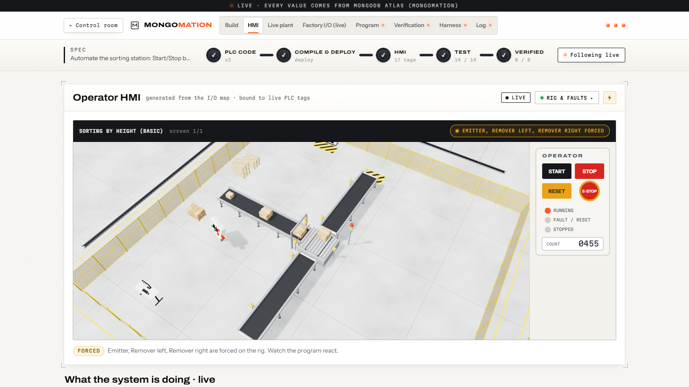 | 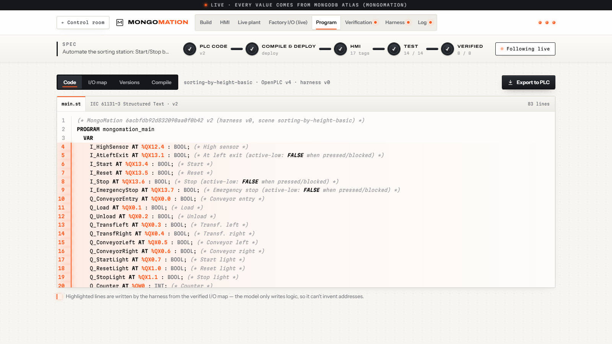 |
| **Verification (per-attempt tests, hidden tests masked)** | **Harness (versions, latest change, proposals)** |
| 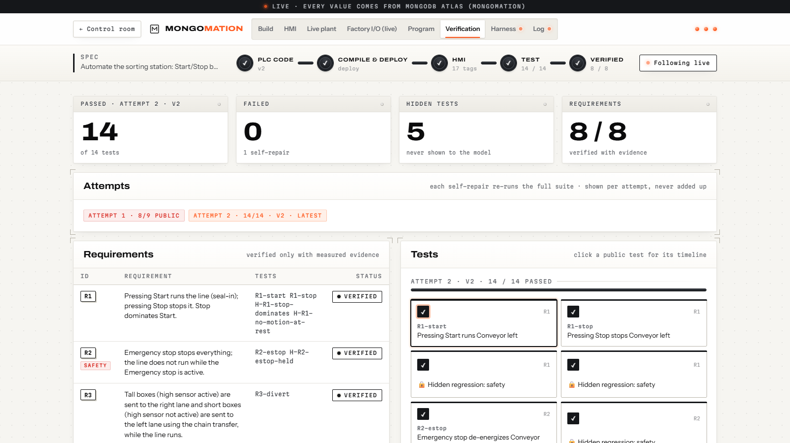 | 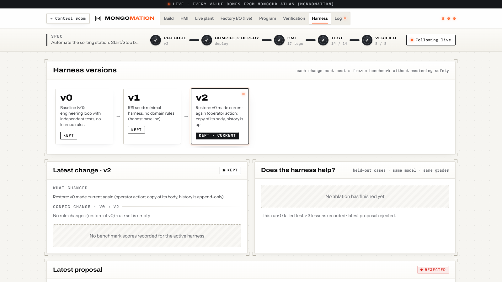 |

---

## How it works

### End-to-end pipeline (Loop 1)

Each stage runs through `runStage()` ([`apps/worker/src/harness/stages.ts`](apps/worker/src/harness/stages.ts)), which writes its output to Atlas before marking it done. Orchestrated by [`apps/worker/src/pipeline/engineer.ts`](apps/worker/src/pipeline/engineer.ts).

| # | Stage | What happens | Atlas writes | Raindrop |
|---|---|---|---|---|
| 0 | `recall` | Look for a proven program: same spec text, same requirement fingerprint, or a hybrid-search near match ([`harness/recall.ts`](apps/worker/src/harness/recall.ts)) | `projects.recall` | `recall_*` signals |
| 1 | `requirements` | LLM extracts structured requirements ([`agents/requirements.ts`](apps/worker/src/agents/requirements.ts)) | `stages` | sub-agent `requirements` |
| 2 | `io_design` | LLM binds roles to real scene tags, then deterministic checks ([`agents/binder.ts`](apps/worker/src/agents/binder.ts)) | `requirements` | `capability_gap` self-diagnostic |
| 3 | `state_machine` (optional) | Design and verify a state machine first (harness flag) | `stages` | sub-agent |
| 4 | `plc_code` | Codegen with retrieved lessons and similar failures ([`agents/codegen.ts`](apps/worker/src/agents/codegen.ts)) | `plc_versions` | `.st` + diff attachments |
| 5 | `preflight` | Static lint and optional local MatIEC compile ([`tools/preflight.ts`](apps/worker/src/tools/preflight.ts)) | `compile_results` | tool span |
| 6 | `compile` | STruC++ bundle compiled on OpenPLC v4 under the Atlas rig lease ([`tools/openplc.ts`](apps/worker/src/tools/openplc.ts)) | `compile_results` | tool span |
| 7 | `deploy` | Start the runtime, prove the Modbus link with the heartbeat ([`tools/linkprobe.ts`](apps/worker/src/tools/linkprobe.ts)) | `deployments` | tool span |
| 8 | `simulate` / `tests` | Public and hidden tests on the plant ([`pipeline/validate.ts`](apps/worker/src/pipeline/validate.ts), [`checks/src/runner.ts`](checks/src/runner.ts)) | `sim_runs`, `test_results`, `measurements` | one span per test |
| 9 | `diagnosis` | Critic explains failures (hidden ones only as a category) | `diagnoses` | `critic_verdict`, `root_cause` |
| 10 | `repair` | Rewrite or patch; failed tests are re-run first, then a full pass | `repairs`, `plc_versions` | `repair_edit` |
| 11 | `verification` | Per-requirement verdicts; a fully passing program goes to program memory | `projects`, `verified_programs` | `project_verified` / `project_not_verified` |

The fault path ([`apps/worker/src/pipeline/fault.ts`](apps/worker/src/pipeline/fault.ts), "Inject Fault & Improve Harness") forces a real sensor fault through the Factory I/O Web API, confirms it by reading the tag back, runs fault tests, repairs, and then asks the meta-agent for a harness change.

<details>
<summary><b>Job lifecycle (state diagram)</b></summary>

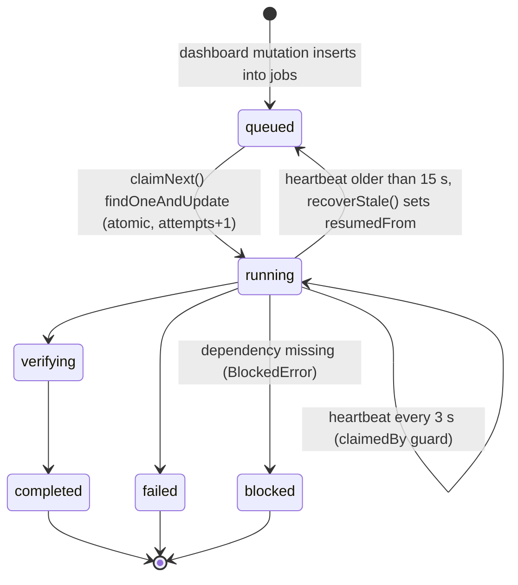

Every transition is captured from the `jobs` change stream with pre- and post-images into `job_transitions` ([`apps/worker/src/db/lineage.ts`](apps/worker/src/db/lineage.ts)).

</details>

<details>
<summary><b>Full architecture diagram</b></summary>

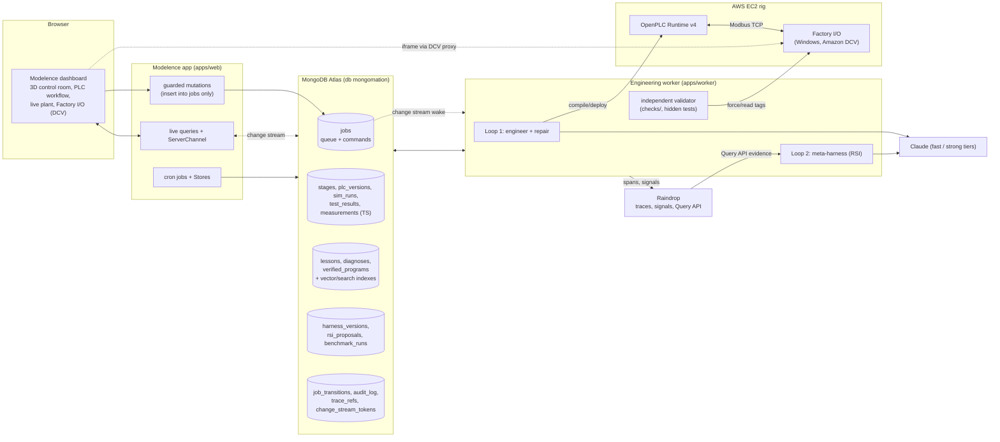

</details>

---

## MongoDB Atlas deep dive

Atlas plays seven roles in MongoMation. The table is the summary; each role has a details block with how it works.

| Role | What Atlas does | Key code | Status |
|---|---|---|---|
| Control plane | Durable job queue: atomic claim, heartbeats, compare-and-set stale recovery | [`harness/jobs.ts`](apps/worker/src/harness/jobs.ts) | Live: 35 jobs, 2 resumed after a crash |
| Event bus | Change streams with persisted resume tokens wake workers and feed the dashboard | [`harness/jobwatch.ts`](apps/worker/src/harness/jobwatch.ts) | Live: 76 audited transitions |
| Durability | Stage checkpoints keyed by input hash; rig lease lock | [`harness/stages.ts`](apps/worker/src/harness/stages.ts), [`harness/riglock.ts`](apps/worker/src/harness/riglock.ts) | Live: 337 checkpoints |
| Integrity | Multi-document transactions for harness decisions; `$jsonSchema` validators | [`rsi/evolve.ts`](apps/worker/src/rsi/evolve.ts), [`db/schema.ts`](apps/worker/src/db/schema.ts) | Implemented and tested; validators applied |
| Telemetry | Time-series `measurements` and window analytics | [`pipeline/validate.ts`](apps/worker/src/pipeline/validate.ts), [`db/analytics.ts`](apps/worker/src/db/analytics.ts) | Live: 82,529 samples |
| Agent memory | Voyage `autoEmbed` vector search + Atlas Search fused with `$rankFusion`; lessons; verified programs; experience recall | [`harness/memory.ts`](apps/worker/src/harness/memory.ts), [`harness/programs.ts`](apps/worker/src/harness/programs.ts), [`harness/recall.ts`](apps/worker/src/harness/recall.ts) | Live: 12 verified programs, 6 search/vector indexes |
| Audit | Pre/post images, harness immutability audit, lineage via `$graphLookup` / `$unionWith` | [`db/lineage.ts`](apps/worker/src/db/lineage.ts) | Live: 0 integrity violations |

Counts are from read-only Atlas queries on 2026-10-11 and grow as the system runs. `npm run ledger` regenerates an evidence ledger with record ids.

<details>
<summary><b>Control plane: durable job queue</b></summary>

- **Where:** [`apps/worker/src/harness/jobs.ts`](apps/worker/src/harness/jobs.ts), [`apps/worker/src/main.ts`](apps/worker/src/main.ts), [`apps/web/src/server/mongomation/mutations.ts`](apps/web/src/server/mongomation/mutations.ts), [`apps/worker/src/launcher.ts`](apps/worker/src/launcher.ts)
- `claimNext()` runs `findOneAndUpdate({status:"queued"}, {$set:{status:"running", claimedBy, heartbeatAt}, $inc:{attempts:1}}, {sort:{createdAt:1}})`. One atomic FIFO claim.
- `heartbeat()` updates only `{_id, claimedBy: me}`. If it matches nothing, the claim was lost.
- `recoverStale()` re-queues `running`/`verifying` jobs whose `heartbeatAt` is older than 15 s, using a compare-and-set on the exact `heartbeatAt` + `claimedBy` it read, and records `resumedFrom`.
- "Interrupt Worker" is itself a job (`type: "worker_command"`); the worker then `exit(137)`s like a crash.
- Indexes `{status:1, createdAt:1}`, `{type:1, status:1, command:1}`, `{status:1, heartbeatAt:1}`; `npm run setup:atlas` runs `explain` on them ([`scripts/atlas-explain.ts`](scripts/atlas-explain.ts)).
- **Why it matters:** without atomic claims two workers would drive the same PLC; without CAS recovery a crashed job would be stranded or run twice.

</details>

<details>
<summary><b>Event bus: change streams and resume tokens</b></summary>

- **Where:** [`apps/worker/src/harness/jobwatch.ts`](apps/worker/src/harness/jobwatch.ts) (`watchJobs`, `durableWatch`, `watchJobTransitions`, `watchHarnessImmutability`), [`apps/worker/src/harness/lessonwriter.ts`](apps/worker/src/harness/lessonwriter.ts), [`apps/web/src/server/mongomation/live.ts`](apps/web/src/server/mongomation/live.ts)
- `watchJobs` uses a server-side `$match` (inserts, and updates that set `status: "queued"`) and wakes the job loop immediately instead of after its 1.5 s poll.
- Resume tokens are persisted per worker in `change_stream_tokens` (TTL 7 d), so a restarted worker replays missed inserts. Error codes 286/280/260 clear the token and polling covers the gap.
- `durableWatch()` is a resumable stream with exponential backoff (1 s to 30 s) used by four streams: job wakeups, job transitions, harness immutability and the lesson writer.
- The dashboard opens one shared change stream over the worker collections and fans it out to every Modelence live query.

</details>

<details>
<summary><b>Durability: stage checkpoints and rig lease</b></summary>

- **Where:** [`apps/worker/src/harness/stages.ts`](apps/worker/src/harness/stages.ts), [`apps/worker/src/harness/riglock.ts`](apps/worker/src/harness/riglock.ts)
- `runStage()` keys each stage by `{projectId, revision, stage, attempt}` (unique index) with a sha256 `inputHash`. A rerun with the same input reuses the stored output ("reused checkpoint from Atlas").
- Side-effecting stages (`compile`, `deploy`) include a process `BOOT_ID` in their input, so they are redone after a restart. Completed `simulate` evidence is reused.
- A spec change starts a new `revision`; only stages whose inputs changed rerun.
- `withRig()` is a lease lock in `rig_locks` (20 s lease, renewed about every 6.7 s, released in `finally`). A dead worker's lease expires.

</details>

<details>
<summary><b>Integrity: transactions and <code>$jsonSchema</code> validators</b></summary>

- **Where:** [`apps/worker/src/db/index.ts`](apps/worker/src/db/index.ts) (`withTxn`, `withTxnRetry`), [`apps/worker/src/rsi/evolve.ts`](apps/worker/src/rsi/evolve.ts), [`apps/worker/src/db/schema.ts`](apps/worker/src/db/schema.ts), [`scripts/setup-atlas.ts`](scripts/setup-atlas.ts)
- **Transaction 1** (`runEvolveRound`): insert the `pending` harness version, enqueue the benchmark job that judges it, and insert the `rsi_proposals` row, all together.
- **Transaction 2** (`runBenchmarkJob`): the harness version's verdict (which decides what every later job runs) and the proposal's verdict, together.
- Both use `readConcern: snapshot`, `writeConcern: majority`, primary reads, with an outer retry on transient errors. Tested in [`apps/worker/test/mongo.test.ts`](apps/worker/test/mongo.test.ts) and [`apps/worker/test/atlas.live.test.ts`](apps/worker/test/atlas.live.test.ts). Live, no proposal has passed the guardrails yet, so these transactions have not committed a candidate in production.
- `harness_versions` validator (`strict`): `workflow.run_regression_tests` must be `true`, `repair_budget` 1..5, at most 24 rules of 8..400 characters, `verdict` in `kept|pending|rolled_back|rejected`. The database, not the worker, refuses a harness that turns off regression tests.
- `jobs`, `test_results`, `rsi_proposals` (`moderate`) and `verified_programs` (`warn`, no test definitions allowed). `ensureValidators()` downgrades to `moderate` if legacy documents would violate `strict`. The live cluster reports `validationAction: warn`; `npm run setup:atlas` re-applies `error`.

</details>

<details>
<summary><b>Telemetry: time-series samples and window analytics</b></summary>

- **Where:** [`scripts/setup-atlas.ts`](scripts/setup-atlas.ts), [`apps/worker/src/pipeline/validate.ts`](apps/worker/src/pipeline/validate.ts), [`apps/web/src/server/mongomation/analytics.ts`](apps/web/src/server/mongomation/analytics.ts), [`apps/worker/src/db/analytics.ts`](apps/worker/src/db/analytics.ts)
- `measurements`: `timeField: ts`, `metaField: meta = {simRunId, testId}`, `granularity: seconds`. One document per sample of `values = {tag: bool | number}`.
- Dashboard analytics use `$setWindowFields` + `$shift`, `$percentile` (p50/p95 sampling gap), `$dateTrunc` + `$densify` + `$fill`, moving averages and a rolling pass rate.
- Worker library: `$derivative`, edge detection, `$bucketAuto` downsampling, `$facet` run summaries, regression drift across runs.
- Because the grader is pure, any stored run can be re-graded from Atlas samples alone. Hidden tests are excluded from every browser-bound query.

</details>

<details>
<summary><b>Agent memory: Voyage vectors, Atlas Search, <code>$rankFusion</code>, experience recall</b></summary>

- **Where:** [`apps/worker/src/harness/memory.ts`](apps/worker/src/harness/memory.ts), [`apps/worker/src/harness/search-indexes.ts`](apps/worker/src/harness/search-indexes.ts), [`apps/worker/src/harness/programs.ts`](apps/worker/src/harness/programs.ts), [`apps/worker/src/harness/recall.ts`](apps/worker/src/harness/recall.ts), [`scripts/setup-search.ts`](scripts/setup-search.ts), [`apps/web/src/server/mongomation/search.ts`](apps/web/src/server/mongomation/search.ts)
- **Vector side:** `lessons_vec`, `diagnoses_vec` and `verified_programs_vec` use Atlas **`autoEmbed`** (Voyage `voyage-4`; `voyage-code-4` for programs). Atlas embeds documents and queries, so the worker holds no embedding key. Filter fields are declared on the index, so `$vectorSearch` pre-filters.
- **Lexical side:** `lessons_search`, `diagnoses_search`, `verified_programs_search` with `lucene.english`, autocomplete, token filters and fuzzy text. Long specs are trimmed to 48 informative terms so PLC addresses like `%IX0.1` survive.
- **Fusion:** `$rankFusion` by default, `$scoreFusion` optionally, then client-side RRF, then recency, as each fails.
- **Lessons:** a change stream on `sim_runs` turns a repair that fixed real failing tests into one "when X, PLC code must Y" rule. It is `active` only after a full rig re-test passed; otherwise `candidate`. Drafts are scanned for hidden test ids and titles. Live: 2 active, 5 candidates.
- **Experience recall:** before codegen, the harness looks for a proven program by exact spec text, by requirement fingerprint, or by a hybrid-search near match. Reuse without a rig run is opt-in (`RECALL_TRUST=1`) and labeled `verified-by-reuse`.

</details>

<details>
<summary><b>Audit, lineage, consistency and least privilege</b></summary>

- `changeStreamPreAndPostImages` on `jobs` and `harness_versions`. `watchJobTransitions` writes idempotent rows to `job_transitions`. `watchHarnessImmutability` logs any illegal change to a decided harness version to `audit_log` (0 so far).
- TTL indexes on `events`, `rig_status`, `change_stream_tokens`, `job_transitions`. Evidence never expires.
- `$graphLookup` walks harness lineage; `$unionWith` merges events, transitions, public test results and trace refs into one timeline ([`apps/worker/src/db/lineage.ts`](apps/worker/src/db/lineage.ts)).
- Client-wide `w: majority`, retryable reads and writes; analytics on `secondaryPreferred` with `maxStalenessSeconds: 90`; search runs with `readConcern: local`.
- Two database users: the worker has `readWrite@mongomation`; the dashboard's custom role `mm_web` can read and only **insert into `jobs`** ([`docs/SETUP.md`](docs/SETUP.md) §2.1).
- [`infra/atlas/`](infra/atlas) holds Atlas Stream Processing, Online Archive and a scheduled trigger. Authored, not applied (billed, M10+).

</details>

<details>
<summary><b>MongoDB feature coverage table</b></summary>

| Feature | Where | What it does |
|---|---|---|
| `findOneAndUpdate` atomic claim | [`harness/jobs.ts`](apps/worker/src/harness/jobs.ts) | FIFO job claim with `$inc: {attempts}` |
| Compare-and-set recovery | [`harness/jobs.ts`](apps/worker/src/harness/jobs.ts) | Re-queue stale jobs without stealing live ones |
| Lease lock with upsert | [`harness/riglock.ts`](apps/worker/src/harness/riglock.ts) | One job on the physical rig at a time |
| Change streams + server-side `$match` | [`harness/jobwatch.ts`](apps/worker/src/harness/jobwatch.ts) | Instant worker wake on insert / command |
| Resume tokens | [`harness/jobwatch.ts`](apps/worker/src/harness/jobwatch.ts) | Replay missed events after restart |
| Pre/post images | [`db/schema.ts`](apps/worker/src/db/schema.ts) | Transition audit, harness immutability audit |
| Multi-document transactions | [`rsi/evolve.ts`](apps/worker/src/rsi/evolve.ts), [`db/index.ts`](apps/worker/src/db/index.ts) | Candidate + benchmark job + proposal; verdict + proposal |
| `$jsonSchema` validators | [`db/schema.ts`](apps/worker/src/db/schema.ts) | `run_regression_tests: true` enforced by the server |
| TTL indexes | [`db/schema.ts`](apps/worker/src/db/schema.ts) | Expire events, rig status, tokens, transitions |
| Time-series collection | [`scripts/setup-atlas.ts`](scripts/setup-atlas.ts) | `measurements` |
| `$setWindowFields`, `$shift`, `$derivative`, `$densify`, `$fill`, `$percentile`, `$bucketAuto`, `$facet` | [`db/analytics.ts`](apps/worker/src/db/analytics.ts), [web `analytics.ts`](apps/web/src/server/mongomation/analytics.ts) | Plant analytics |
| Vector Search with `autoEmbed` (Voyage) and pre-filters | [`scripts/setup-atlas.ts`](scripts/setup-atlas.ts), [`scripts/setup-search.ts`](scripts/setup-search.ts) | Atlas-side embeddings for lessons, diagnoses, programs |
| Atlas Search (fuzzy, autocomplete, highlight, `$searchMeta` facets) | [`harness/memory.ts`](apps/worker/src/harness/memory.ts), [web `search.ts`](apps/web/src/server/mongomation/search.ts) | Lexical retrieval and dashboard search |
| `$rankFusion` / `$scoreFusion` | [`harness/memory.ts`](apps/worker/src/harness/memory.ts) | Hybrid fusion with fallback |
| `$graphLookup`, `$lookup` pipeline, `$unionWith` | [`db/lineage.ts`](apps/worker/src/db/lineage.ts) | Lineage and evidence timeline |
| Multikey index | [`db/schema.ts`](apps/worker/src/db/schema.ts) | `trace_refs.evidenceIds` to Raindrop trace |
| Read preference, max staleness, causal sessions | [`db/index.ts`](apps/worker/src/db/index.ts) | Analytics offload, read-your-writes |
| Custom role (least privilege) | [`docs/SETUP.md`](docs/SETUP.md) | Dashboard can only insert into `jobs` |

</details>

<details>
<summary><b>Data model: collections reference</b></summary>

All collections live in database `mongomation` (env `MONGODB_DB`). W = writer, R = reader.

| Collection | Purpose | Key fields | Validator / TTL / TS | W | R |
|---|---|---|---|---|---|
| `jobs` | Work queue + worker commands | `type`, `status`, `claimedBy`, `heartbeatAt`, `attempts`, `resumedFrom`, `projectId`, `raindropEventId` | `$jsonSchema`; pre/post images | Web (insert), Worker | Worker, Web |
| `workers` | Worker liveness | `host`, `pid`, `heartbeatAt` | none | Worker | Web |
| `projects` | One engineering project | `specText`, `sceneId`, `status`, `verdicts`, `recall`, `fingerprint` | none | Worker | Web, RSI |
| `stages` | Stage checkpoints | `projectId`, `revision`, `stage`, `attempt`, `inputHash`, `output` | unique key | Worker | Worker, Web |
| `events` | Stage log lines | `projectId`, `stage`, `level`, `message`, `ts` | TTL 30 d | Worker | Web |
| `requirements` | Bound requirements + I/O table | `requirements`, `io`, `sceneId` | none | Worker | Web |
| `plc_versions` | Every program version | `version`, `source`, `sourceHash`, `createdBy`, `diffFromPrevious` | none | Worker | Web |
| `compile_results`, `deployments` | Compile logs, runtime starts | `plcVersionId`, `ok`, `log`, `linkUpMs` | none | Worker | Web |
| `sim_runs` | One test-plan execution | `plcVersionId`, `planHash`, `split`, `passed`, `failed`, `blocked`, `verdicts` | none | Worker | Web, RSI |
| `test_results` | One test verdict | `testId`, `verdict`, `visibility`, `assertions`, `simRunId` | `$jsonSchema` | Worker | Web (public only), RSI |
| `measurements` | Plant samples | `ts`, `meta.simRunId`, `meta.testId`, `values` | time series | Worker | Web analytics |
| `fault_injections` | Forced sensor faults | `faultId`, readback | none | Worker | Web |
| `diagnoses`, `repairs` | Critic output, repair records | `causes`, `lessons`, `diagnosisId`, `tier`, `traceId` | vector + search indexes | Worker | memory |
| `lessons` | Lessons memory | `pattern`, `fix`, `active`, `status`, `support` | vector + search indexes | Worker | codegen, meta-agent |
| `verified_programs` | Program memory | `specText`, `stSource`, `embedText`, test counts only | `$jsonSchema` warn; vector + search | Worker | codegen, recall |
| `harness_versions` | Versioned harness config | `version`, `parent`, `verdict`, `rules`, `workflow` | `$jsonSchema` strict; pre/post images | Worker | Worker, Web |
| `rsi_proposals` | Meta-agent proposals | `change`, `verdict`, `guardrailViolations`, `citedRunIds` | `$jsonSchema` | Worker | Web |
| `benchmark_runs`, `benchmark_manifests` | Gate and ablation rows, frozen benchmark hash | `condition`, `caseId`, `scores`, `hash` | none | Worker | Web |
| `scenes` | Factory I/O scene registry | `tags`, address map, `verified` | none | `npm run seed` | Worker, Web |
| `rig_locks`, `rig_status` | Rig lease, live tags + health | `holder`, `leaseUntil`, `tags`, `dcvUrl` | TTL 14 d on status | Worker | Worker, Web |
| `trace_refs` | Atlas evidence to Raindrop event | `eventId`, `evidenceIds` | multikey index | Worker | Web, ledger |
| `change_stream_tokens`, `job_transitions`, `audit_log` | Resume tokens, job audit, integrity alerts | `token`, `from`, `to`, `kind` | TTL 7 d / 30 d / kept | Worker | Worker, Web |
| Modelence Stores `mmNotes`, `mmPreferences`, `mmOpsAlerts`, `mmOpsDigests` | App-owned data | see [`stores.ts`](apps/web/src/server/mongomation/stores.ts) | Modelence schema | Web | Web |

</details>

---

## Raindrop deep dive

Raindrop is the agent's flight recorder and an input to its self-improvement: telemetry flows out of every model call and rig step, and Raindrop's aggregates flow back into the meta-agent.

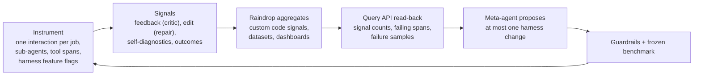

| Capability | What we use it for | Key code | Status (30 days to 2026-10-11) |
|---|---|---|---|
| Interactions, sub-agents, tool spans | One trace per job: every agent call and every rig step nested | [`telemetry/raindrop.ts`](apps/worker/src/telemetry/raindrop.ts) | 640 events |
| Crash-safe resume | `resumeInteraction` keeps one trace per job across `kill -9` | [`main.ts`](apps/worker/src/main.ts) | Live |
| Feature flags | `harness_version` and routing tags on every event, so outcomes split by harness | [`telemetry/index.ts`](apps/worker/src/telemetry/index.ts) | Live |
| Typed signals | Critic `feedback`, repair `edit`, self-diagnostics, outcomes | [`pipeline/engineer.ts`](apps/worker/src/pipeline/engineer.ts) | 16 signals with hits |
| Query API read-back | The meta-agent reads signal counts and failing spans before proposing | [`telemetry/raindrop-query.ts`](apps/worker/src/telemetry/raindrop-query.ts), [`rsi/evolve.ts`](apps/worker/src/rsi/evolve.ts) | Live, fail-soft |
| Datasets, dashboards | Regression sets and harness-health views | Raindrop project | 2 datasets, 2 dashboards |
| Atlas join | Every Raindrop event id stored next to the Atlas evidence it produced | [`db/traces.ts`](apps/worker/src/db/traces.ts) | 644 trace refs |

<details>
<summary><b>Signals and their 30-day hits</b></summary>

| Signal | Raindrop type | Attached to | Hits |
|---|---|---|---|
| Simulator test failed | default, negative | the test's tool event | 37 |
| Critic verdict | **feedback** (comment = critique) | the event that wrote the failing program | 9 |
| Repair edit | **edit** (after = repaired program) | the event whose program was repaired | 9 |
| Project not verified / Project verified | default | job event | 7 / 6 |
| Repair budget exhausted | default, negative | job event | 5 |
| Self diagnostics: root cause / capability gap | **Self Diagnostics** | critic / binder event | 7 / 1 |
| Recall trusted spec / Project verified by reuse / Recall near | default | job event | 2 / 2 / 1 |
| Harness proposal rejected | default, negative | meta-agent event | 1 |
| `plc_compile_failed`, `agent_call_failed`, `harness_change_kept`, `harness_change_rolled_back`, `refusal` | various | instrumented in code | 0 (has not occurred) |

Custom code signals defined in Raindrop over the same events: "PLC Requirement Violations" (18), "Incorrect PLC I/O Mapping" (6), "PLC Repair Nonconvergence" (6), "Repair Overrides Critic" (5).

</details>

<details>
<summary><b>Instrumentation details</b></summary>

- `begin()` per job (`convoId` = project id); `setUserDetails` identifies the worker.
- Every LLM call is a `trackAi` event with token usage, `cost_usd` and latency, and a sub-agent of the job (`interaction.subagent()` + `startSpan("agent:<name>")`).
- `trackTool` spans for preflight, compile, deploy and every simulator test, with Atlas `evidenceIds` and `error` on failure. Skipped steps are not errors.
- `addAttachments`: the generated `.st` program, its diff, and the compile log on failure.
- Every SDK call is wrapped in `guard()`, so telemetry can never break engineering. Without `RAINDROP_WRITE_KEY` telemetry is disabled and trace ids are `null`, never invented.
- `RaindropQuery` calls `/v1/signals`, `/v1/events/count`, `/v1/events/timeseries`, `/v1/events/error-span-facets` and `/v1/events?signal=` to build a 7-day summary for the meta-agent prompt. Guardrails check that cited run ids are real Atlas `sim_runs`, never Raindrop ids.

</details>

<details>
<summary><b>Datasets, dashboards and Workshop evals</b></summary>

- **Datasets:** "MongoMation failing interactions" (26 rows) and "MongoMation verified successes" (12 rows).
- **Dashboards:** "MongoMation harness health" (12 panels: verification and pass rate by harness version, cost per verified project, experiment cohorts) and "MongoMation — RSI learning curve" (9 panels: wall time, cost and repairs per job, recall mix).
- **Workshop evals:** [`scripts/workshop-eval.ts`](scripts/workshop-eval.ts) (`npm run workshop:eval`) imports job traces into a local Raindrop Workshop and scores each run per `harness_version`. Hosted Raindrop Evals returned 403 on our org, so evals run in Workshop. A Workshop MCP server can be registered for coding agents in a local, gitignored `.mcp.json` ([`docs/ARCHITECTURE.md`](docs/ARCHITECTURE.md) §7).

</details>

---

## Self-improvement loop (RSI)

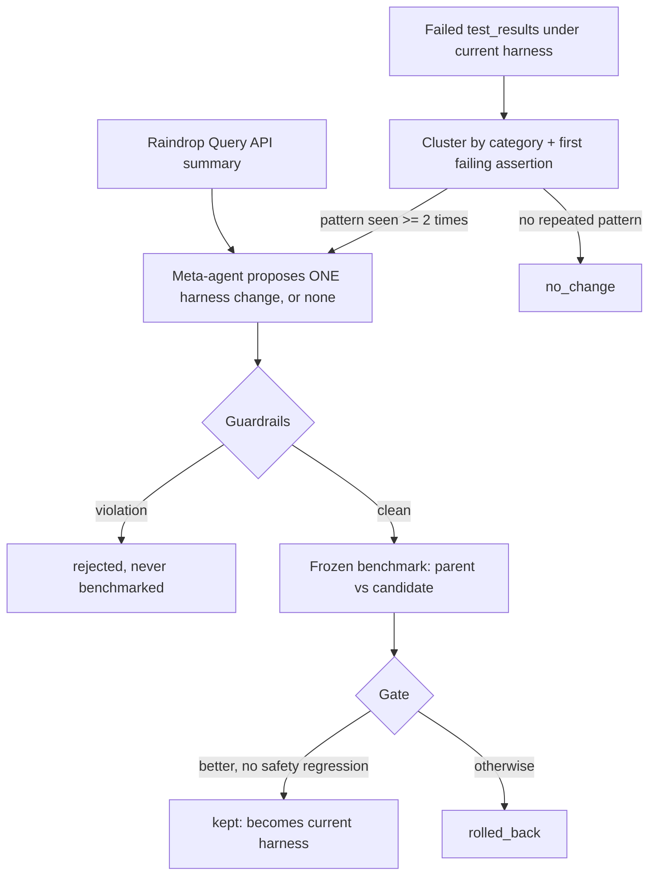

| Part | Code | Rule |
|---|---|---|
| Meta-agent | [`rsi/meta.ts`](apps/worker/src/rsi/meta.ts) | Edits only the harness; "no change" is a valid answer |
| Guardrails | [`rsi/guardrails.ts`](apps/worker/src/rsi/guardrails.ts) | Strict schema, append-only rules, no skipping checks, cited runs must exist |
| Gate | [`rsi/gate.ts`](apps/worker/src/rsi/gate.ts) | Blocked tests = inconclusive; any hidden-safety regression = rolled back; then satisfaction > 5 points, compile rate, repairs, cost |
| Frozen benchmark | [`specs/benchmark.json`](specs/benchmark.json) | 4 train + 2 held-out cases, sha256 recorded in `benchmark_manifests` |
| Ablation | `npm run ablation` | Held-out cases: bare one-shot vs v0 vs current harness |

**Where it stands (2026-10-11):** 9 proposals. 7 `no_change`: in most rounds no failure pattern repeated twice, and in one round the meta-agent traced repeated failures to a flawed test oracle rather than the code and declined to change the harness. 2 `rejected` by the schema guardrail because a proposed rule exceeded 400 characters. The meta-agent prompt now states the limit ([`rsi/meta.ts`](apps/worker/src/rsi/meta.ts)); no round has run since the fix. Harness versions v1 and v2 are operator seed and restore versions, not gate decisions. **No harness change has been kept by the gate yet**, and no ablation has finished.

---

## Modelence

The production dashboard ([`apps/web`](apps/web)) is deployed on Modelence Cloud: a 3D control room, the PLC workflow page (Build, HMI, Live plant, Factory I/O, Program, Verification, Harness, Log), and live updates from Atlas.

| Modelence feature | Where | Use |
|---|---|---|
| `startApp`, roles, email auth, rate limits | [`app.ts`](apps/web/src/server/app.ts) | Sign-in, verified email, `admin` / `operator` roles |
| `Module` with `configSchema` | [`mongomation/index.ts`](apps/web/src/server/mongomation/index.ts) | Atlas URI and options per environment |
| Live queries over one shared change stream | [`live.ts`](apps/web/src/server/mongomation/live.ts), [`liveQueries.ts`](apps/web/src/server/mongomation/liveQueries.ts) | Real-time dashboard without polling |
| `ServerChannel` | [`live.ts`](apps/web/src/server/mongomation/live.ts) | Push worker events (hidden test ids scrubbed) |
| Guarded mutations | [`mutations.ts`](apps/web/src/server/mongomation/mutations.ts), [`guards.ts`](apps/web/src/server/mongomation/guards.ts) | Only ever insert into `jobs`, validated and rate-limited |
| Cron jobs + Stores | [`crons.ts`](apps/web/src/server/mongomation/crons.ts), [`stores.ts`](apps/web/src/server/mongomation/stores.ts) | Rig/job watchdogs, ops digest, notes |
| `@modelence/ai` | [`notes.ts`](apps/web/src/server/mongomation/notes.ts) | "Explain this failure" notes |

UI code: [`pages/RoomPage.tsx`](apps/web/src/client/pages/RoomPage.tsx) and [`plc3d/plcroom.js`](apps/web/src/client/plc3d/plcroom.js) (three.js control room), [`pages/PlcWorkflowPage.tsx`](apps/web/src/client/pages/PlcWorkflowPage.tsx) (workflow), [`components/workflow/tabs/`](apps/web/src/client/components/workflow/tabs) (tabs). The live plant tab renders frames from the software-in-the-loop plant in [`apps/plant-sim`](apps/plant-sim).

---

## AWS

| Piece | Status | Where |
|---|---|---|
| OpenPLC Runtime v4 on Linux EC2 | **Live**, the authoritative compile and runtime | [`tools/openplc.ts`](apps/worker/src/tools/openplc.ts) |
| Factory I/O on Windows GPU EC2 (Web API + Modbus) | **Live**, the plant every test runs on | [`tools/factoryio.ts`](apps/worker/src/tools/factoryio.ts) |
| Amazon DCV stream of the plant | **Live**, embedded in the dashboard via a local proxy | [`FactoryIoTab.tsx`](apps/web/src/client/components/workflow/tabs/FactoryIoTab.tsx), [`dcv-proxy.mjs`](apps/web/scripts/dcv-proxy.mjs) |
| SSM port forwarding | Fallback access path and plant-sim Modbus link | [`docs/SETUP.md`](docs/SETUP.md) §5, [`apps/plant-sim/README.md`](apps/plant-sim/README.md) |
| S3, CloudWatch, SSM Run Command, Secrets Manager, EC2 power | **Written, flag-gated, not deployed** (no `MM_AWS_*` flag is set) | [`apps/worker/src/aws/`](apps/worker/src/aws), [`scripts/rig-power.ts`](scripts/rig-power.ts) |
| CloudFormation stack | **Authored, not deployed** | [`infra/aws/template.ts`](infra/aws/template.ts) |

---

## Repo map

```
apps/
  worker/            engineering worker (TypeScript, tsx)
    src/main.ts        ENTRY: job loop, rig monitor, change-stream watchers
    src/launcher.ts    ENTRY: supervisor for Interrupt / Resume
    src/agents/        LLM agents: requirements, binder, codegen, state machine, critic, repair
    src/pipeline/      engineer.ts (Loop 1), fault.ts, validate.ts (only importer of checks/), st.ts (I/O block)
    src/harness/       jobs, jobwatch, stages, riglock, config, memory, search-indexes, programs, recall, lessonwriter, seed
    src/rsi/           evolve (Loop 2), meta (meta-agent), guardrails, gate
    src/telemetry/     Raindrop SDK sink, Query API client
    src/db/            client + transactions, schema, analytics, lineage, traces
    src/tools/         openplc, factoryio, llm, preflight, linkprobe, connect, rig
    src/aws/           S3, CloudWatch, SSM, Secrets Manager, EC2 (flag-gated)
    test/              node:test suites
  web/               Modelence dashboard (separate package)
    src/server/app.ts  ENTRY: startApp
    src/server/mongomation/  queries, live queries, mutations, guards, crons, stores, search, lineage
    src/client/        React UI: pages/, plc3d/ (three.js), components/workflow/tabs/
  plant-sim/         software-in-the-loop plant (Modbus TCP to OpenPLC)
packages/types/      shared contracts with zod
checks/              independent validator: pure grader, plan, runner, templates, hidden tests
harness/v0.json      baseline harness
scenes/              Factory I/O scene registry (address map, faults, setup, timing)
specs/               examples.json (Run Example), benchmark.json (frozen)
scripts/             setup-atlas, setup-search, seed, evolve, ledger, learning-curve, workshop-eval, rig-*
infra/atlas/         Stream Processing, Online Archive, trigger (authored, not applied)
infra/aws/           CloudFormation template (not deployed)
docs/                ARCHITECTURE, SETUP, DEMO, SUBMISSION, INTEGRATION_CONTRACT, research/, img/
```

| Doc | What it is |
|---|---|
| [`docs/ARCHITECTURE.md`](docs/ARCHITECTURE.md) | Components, both loops, durability, Raindrop Workshop |
| [`docs/SETUP.md`](docs/SETUP.md) | Install, Atlas users, STruC++, rig access |
| [`docs/DEMO.md`](docs/DEMO.md) | Live demo script and operator checklist |
| [`docs/SUBMISSION.md`](docs/SUBMISSION.md) | Hackathon submission text and measured results |
| [`docs/INTEGRATION_CONTRACT.md`](docs/INTEGRATION_CONTRACT.md) | The rig contract between the AWS and app developers |
| [`docs/probe-sorting-by-height-basic.st`](docs/probe-sorting-by-height-basic.st) | Generated I/O probe used to verify the scene's address map |
| [`docs/research/`](docs/research) | Verified API notes: OpenPLC, Factory I/O, MongoDB, Raindrop, Modelence |

---

## How to run, test and verify

```bash
# root workspace (worker, checks, types, scripts); Node >= 22.13
npm install
cp .env.example .env            # fill in values (names below)
npm test                        # unit tests
npm run typecheck
npm run verify:isolation        # agents/ and rsi/ cannot reach the validator or hidden tests
npm run green                   # live check: atlas, claude, raindrop, preflight, openplc, factoryio

# Atlas setup (idempotent)
npm run setup:atlas             # collections, indexes, time series, TTL, validators, vector indexes
npm run setup:search -- --wait  # Atlas Search indexes
npm run seed                    # harness v0 + scene registry

# run
npm run worker                  # the engineering worker
npm run launcher                # worker under the Interrupt/Resume supervisor
npm run example                 # enqueue a Run Example job
npm run fault                   # inject a fault and improve
npm run evolve                  # one RSI round (gate benchmark: npm run benchmark; held-out: npm run ablation)
npm run ledger                  # evidence ledger from Atlas

# dashboard (Modelence)
cd apps/web && npm install && npm run dev
```

<details>
<summary><b>All root npm scripts</b></summary>

| Script | Purpose |
|---|---|
| `typecheck`, `test`, `verify:isolation` | Static checks, unit tests, isolation check |
| `green` | Live dependency check |
| `setup:atlas`, `setup:search`, `seed` | Atlas schema, search indexes, baseline data |
| `memory:backfill`, `lessons:backfill`, `recall:backfill` | Backfill program memory, lessons, recall keys from past runs |
| `preflight` | Local MatIEC compile of an ST file |
| `worker`, `launcher` | Run the worker (plain / supervised) |
| `example`, `fault` | Enqueue a Run Example / fault-and-improve job |
| `harness:seed`, `harness:restore` | Operator harness versions (append-only) |
| `evolve`, `benchmark`, `ablation` | RSI round, gate benchmark, held-out ablation |
| `rig:smoke` | Rig smoke test (read-only) |
| `ledger`, `export` | Evidence ledger, project export |
| `probe` | Generate a scene I/O probe program |
| `raindrop:smoke`, `raindrop:eval`, `workshop:start`, `workshop:eval` | Raindrop smoke test, Workshop evals |

</details>

---

## Environment variables

Names only. Values live in `.env` / `.env.rig` (gitignored). Template: [`.env.example`](.env.example).

| Area | Variables |
|---|---|
| Atlas | `MONGODB_URI` (worker user), `MONGODB_URI_WEB` (dashboard user), `MONGODB_DB`, `EVENTS_TTL_DAYS`, `RIG_STATUS_TTL_DAYS`, `JOB_TRANSITIONS_TTL_DAYS` |
| Memory / search / recall | `EMBEDDING_MODE`, `EMBEDDING_MODEL`, `EMBEDDING_DIMS`, `VOYAGE_API_KEY`, `VOYAGE_BASE_URL`, `SEARCH_FUSION`, `SEARCH_RERANK`, `RERANK_MODEL`, `PROGRAMS_EMBEDDING_MODEL`, `MEMORY_PROGRAMS`, `LESSON_WRITER`, `RECALL_TRUST`, `RECALL_NEAR_SCORE` |
| Models | `ANTHROPIC_API_KEY`, `MODEL_STRONG`, `MODEL_FAST` |
| Raindrop | `RAINDROP_WRITE_KEY`, `RAINDROP_PROJECT_ID`, `RAINDROP_QUERY_API_KEY`, `RAINDROP_QUERY_URL`, `RAINDROP_CLOUD_PER_TEST`, `RAINDROP_WORKSHOP`, `RAINDROP_LOCAL_DEBUGGER`, `RAINDROP_REDACT_PII`, `RAINDROP_DEBUG`, `WORKSHOP_EVAL_STRICT` |
| Rig | `RIG_ID`, `RIG_INSTANCE`, `RIG_REGION`, `RIG_FIO_HOST`, `SCENE_ID`, `DCV_URL`, `OPENPLC_URL`, `OPENPLC_FLAVOR`, `OPENPLC_USER`, `OPENPLC_PASSWORD`, `OPENPLC_PASSWORD_SSM_PARAM`, `OPENPLC_BUILDER`, `OPENPLC_INSECURE_TLS`, `FACTORYIO_URL`, `FACTORYIO_INSECURE_TLS`, `FACTORYIO_HOST_HEADER`, `FACTORYIO_RELINK_MS`, `FACTORYIO_LINK_TIMEOUT_MS`, `TEAM_API_KEY`, `ALLOW_NO_RIG`, `WORKER_ID` |
| Preflight | `IEC2C_PATH`, `IEC_LIB`, `OPENPLC_C_LIB` |
| AWS (all off by default) | `MM_AWS_REGION`, `MM_AWS_ARTIFACTS_BUCKET`, `MM_AWS_METRICS`, `MM_AWS_LOG_GROUP`, `MM_AWS_SSM_SECRETS`, `MM_AWS_SECRETS_ID`, `MM_AWS_RIG_HEALTH` and related `MM_AWS_*` |
| Plant sim | `PLC_MODBUS_HOST`, `PLC_MODBUS_PORT`, `PLC_MODBUS_UNIT`, `PLANT_SIM_PORT`, `PLANT_SIM_AUTO` |

---

## Glossary

| Term | Meaning |
|---|---|
| **Harness** | Everything around the model that does the engineering: rules, retrieved context, workflow, repair strategy and model routing. Versioned JSON in `harness_versions` ([`harness/v0.json`](harness/v0.json)). |
| **Kept / rolled back / rejected / no change** | Gate outcomes. Kept: beat its parent on the frozen benchmark. Rolled back: did not, or evidence was blocked. Rejected: guardrails refused it before any benchmark. No change: no repeated failure pattern, or the meta-agent chose not to change anything. |
| **Public / hidden tests** | Public tests are visible to the agents. Hidden tests probe the same requirements from another angle and never reach any model, retrieval or the browser. |
| **Blocked** | Not enough measured evidence. Never counted as passed. |
| **Verified / verified-by-reuse** | Verified: every test covering every requirement passed on the rig in this job. Verified-by-reuse: an identical spec's proven program was replayed without a new rig run. |
| **Rig** | One OpenPLC runtime + one Factory I/O scene on AWS EC2, guarded by the Atlas lease in `rig_locks`. |
| **Scene** | A Factory I/O plant with its verified address map ([`scenes/`](scenes)). |
| **ST** | IEC 61131-3 Structured Text, the PLC language generated here. |
| **CAB** | A PLC cabinet in the 3D control room; `/plc/:cab` opens its workflow page. |
| **DCV** | Amazon DCV, which streams the Factory I/O desktop. |
| **Trace ref** | Row in `trace_refs` linking an Atlas evidence id to a Raindrop event id. |

---

## Status and honest limits

Snapshot 2026-10-11.

- **Proven on the real rig:** the full engineering loop (11 verified projects; best custom run 8/8 requirements and 14/14 tests after one repair; largest run 25/25 first try). Crash and resume from Atlas (2 recovered jobs). Change-stream wakeups and transition audit. Hybrid search, lesson writer, program memory and exact-spec recall. Raindrop tracing, typed signals, datasets and dashboards.
- **Self-improvement is a working mechanism, not a measured gain.** 9 proposals: 7 no change, 2 rejected by the 400-character rule limit (prompt fixed, not yet re-run). No harness change has been kept by the gate, and no ablation has finished.
- **Recall:** a fuzzy (near) recall did not make its run faster in our one measured case. Exact-spec recall works, but `verified-by-reuse` means the program was not re-tested in that job.
- **Requirement extraction is not deterministic** on identical spec text; spec-level recall works around it rather than fixing it.
- **Scope:** one scene, one rig, one PLC vendor. Gateway sampling gaps can block tests; blocked tests are reported, never passed.
- **Authored, not applied:** Atlas Stream Processing, Online Archive and the scheduled trigger (billed, M10+). AWS S3/CloudWatch/SSM/Secrets Manager modules and the CloudFormation stack (flag-gated). Hosted Raindrop Evals returned 403, so evals run in Workshop.

---

## Further reading

- [`docs/ARCHITECTURE.md`](docs/ARCHITECTURE.md): architecture and Raindrop Workshop details
- [`docs/SETUP.md`](docs/SETUP.md): setup, least-privilege users, rig access
- [`docs/DEMO.md`](docs/DEMO.md): demo script and operator checklist
- [`docs/SUBMISSION.md`](docs/SUBMISSION.md): hackathon submission and results
- [`docs/INTEGRATION_CONTRACT.md`](docs/INTEGRATION_CONTRACT.md): AWS rig contract
- [`docs/research/`](docs/research): verified API notes
- [`AGENTS.md`](AGENTS.md): rules for coding agents

## License

[MIT](LICENSE)
