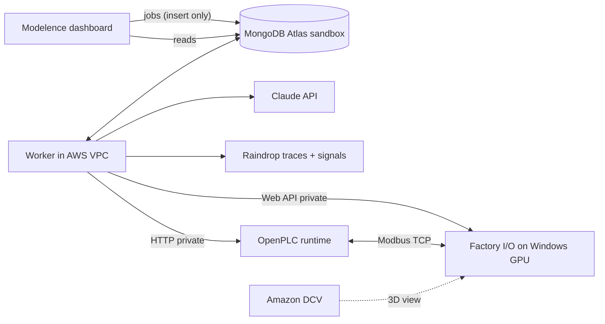

# MongoMation — architecture

> Describe the machine. We engineer the control system. The harness gets smarter.

**Thesis:** the engineering agent learns to fix the machine's program; the recursive harness learns to become a
better engineer for the next machine. Both loops run against real tools — OpenPLC compilation, a live Factory I/O
simulation on AWS, MongoDB Atlas as memory — and nothing is graded by the model that wrote it.

## 1. Three components (deliberately few)

| Component | Code | Job |
|---|---|---|
| **Engineering agent** | `apps/worker/src/agents/` | spec → requirements → I/O binding → (state machine) → Structured Text; diagnoses measured failures; repairs |
| **Independent validator** | `checks/` (+ `apps/worker/src/pipeline/validate.ts`) | builds deterministic test plans from requirements + scene; drives the real simulator; grades measured samples with a pure grader; hidden regression tests |
| **Persistent harness** | `apps/worker/src/harness/`, `apps/worker/src/rsi/` | job queue + leases + heartbeats, stage checkpoints, rig lock, memory, versioned config, guardrails, benchmark, gate |

## 2. Loop 1 — engineering repair (improves the PLC program)

`requirements → io_design → state_machine? → plc_code → preflight (MatIEC) → compile (OpenPLC) → deploy → simulate (Factory I/O) → tests → diagnosis → repair → … → verification → deliver`

- The **harness writes every located variable** from the scene's verified I/O map; the model writes internal
  variables and logic only, so addresses can't be hallucinated (`pipeline/st.ts`).
- **Static checks** (inputs never written, every output assigned, no WHILE/REPEAT) and a **local MatIEC preflight**
  catch errors in ~1.5 s before the shared rig is touched. The OpenPLC runtime compile is authoritative.
- **Tests are data** (`TestCase.steps`), executed against the live rig while sampling tags every 50 ms; the
  **pure grader** decides from samples: a pass needs a measured sample, missing data is BLOCKED, never a pass.
- A requirement is **VERIFIED** only if every public and hidden test covering it passed with evidence.
  Unsupported equipment → UNSUPPORTED; no primitive yet → UNTESTED. Nothing is claimed without measurements.
- Every PLC version, diff, compile log, sample and verdict is in Atlas with ids that link them.

## 3. Loop 2 — recursive self-improvement (improves the harness)

1. **Evidence:** failed test results under the current harness version (train split only), clustered by
   category + failed assertion; critic diagnoses; Raindrop event ids (`rsi/evolve.ts: collectEvidence`).
2. **Meta-agent** (`rsi/meta.ts`) proposes **at most one** change to rules / context / workflow / repair / routing —
   or **no change**. Repeated patterns only (≥2 occurrences); handled faults do not invent failures.
3. **Guardrails** (`rsi/guardrails.ts`, immutable): strict schema (no smuggled fields), `run_regression_tests`
   literal true, rules append-only, no rule that skips/silences/declares/mentions hidden tests or benchmarks,
   preflight and adopted state-machine checks can't be turned off, budget step ≤ 1, must cite real failed runs.
   Violation → **REJECTED** (stored, never benchmarked).
4. **Benchmark** (`specs/benchmark.json`, frozen by hash in Atlas): train cases under parent and candidate,
   same model, same scene, same validator, ground-truth requirements per case.
5. **Gate** (`rsi/gate.ts`): safety never regresses; requirement satisfaction must rise by > 5 points, or tie and
   compile/repair/cost improve → **KEPT** (becomes current); otherwise **ROLLED BACK**.
6. **Ablation** on held-out cases: bare one-shot model vs harness v0 vs evolved vN (same model).

## 4. Long-horizon durability

- `jobs`: atomic claim, 3 s heartbeats, stale (15 s) jobs re-queued with `resumedFrom`.
- `stages`: each stage's output persisted before it's marked done; on resume, stages with a matching input hash
  are reused from Atlas ("reused checkpoint" events) and only the interrupted stage re-runs.
- Side effects reconcile real state: forced tags released on worker start and before every test run; the program
  is recompiled/started by hash before simulation; the rig lock is a lease that expires if its holder dies.
- **Interrupt Worker** = dashboard command → worker exits 137 mid-stage (a real crash, no cleanup).
  **Resume from MongoDB** = start the worker again → it recovers the job and continues from the checkpoints.
- **Spec change mid-project** = new revision: unchanged inputs reuse checkpoints, the previously verified program
  is the baseline for minimal edits, and the full regression plan re-runs.

## 5. Data model (Atlas, db `mongomation`)

`projects, jobs, stages, events, requirements, plc_versions, compile_results, deployments, sim_runs, test_results,
measurements (time series), fault_injections, diagnoses, repairs, lessons (vector), harness_versions,
rsi_proposals, benchmark_runs, benchmark_manifests, workers, scenes, rig_locks, rig_status, trace_refs`.
Vector Search: `lessons_vec`, `diagnoses_vec` (Voyage embeddings; retrieval falls back to recency without a key).

## 6. Sponsors, used for real

| Sponsor | Where |
|---|---|
| MongoDB Atlas | all state, queue, checkpoints, time-series measurements, vector memory, versioned harness, MCP for dev inspection |
| Raindrop | one interaction per job, every model call (`trackAi` + usage), tool spans with errors, signals for failures/verdicts; Query API/MCP for RSI evidence |
| AWS | EC2 Windows GPU (Factory I/O), OpenPLC, worker in the VPC, DCV for the 3D view |
| Modelence | the dashboard app and its deployment |
