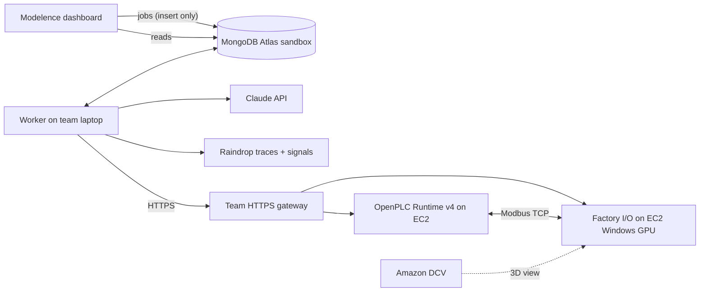

# MongoMation — architecture

> Describe the machine. We engineer the control system. The harness gets smarter.

**Thesis:** the engineering agent learns to fix the machine's program; the recursive harness learns to become a
better engineer for the next machine. Both loops run against real tools — OpenPLC compilation, a live Factory I/O
simulation on AWS, MongoDB Atlas as memory — and nothing is graded by the model that wrote it.

## 1. Three components (deliberately few)

| Component | Code | Job |
|---|---|---|
| **Engineering agent** | `apps/worker/src/agents/` | spec → requirements → I/O binding → (state machine) → Structured Text; diagnoses measured failures; repairs |
| **Independent validator** | `checks/` (+ `apps/worker/src/pipeline/validate.ts`) | builds deterministic test plans from requirements + scene; drives the real simulator; grades measured samples with a pure grader; hidden regression tests |
| **Persistent harness** | `apps/worker/src/harness/`, `apps/worker/src/rsi/` | job queue + leases + heartbeats, stage checkpoints, rig lock, memory, versioned config, guardrails, benchmark, gate |

## 2. Loop 1 — engineering repair (improves the PLC program)

`requirements → io_design → state_machine? → plc_code → static checks → STruC++ build (OpenPLC Runtime v4 bundle) → compile (OpenPLC) → deploy → simulate (Factory I/O) → tests → diagnosis → repair → … → verification → deliver`

- The **harness writes every located variable** from the scene's verified I/O map; the model writes internal
  variables and logic only, so addresses can't be hallucinated (`pipeline/st.ts`).
- **Static checks** (inputs never written, every output assigned, no WHILE/REPEAT) catch errors locally before the
  shared rig is touched. The **STruC++ build** targets OpenPLC Runtime v4. A MatIEC preflight is optional and not
  available in this setup. The OpenPLC runtime compile is authoritative.
- **Tests are data** (`TestCase.steps`), executed against the live rig while sampling tags every 50 ms; the
  **pure grader** decides from samples: a pass needs a measured sample, missing data is BLOCKED, never a pass.
- A requirement is **VERIFIED** only if every public and hidden test covering it passed with evidence.
  Unsupported equipment → UNSUPPORTED; no primitive yet → UNTESTED. Nothing is claimed without measurements.
- Every PLC version, diff, compile log, sample and verdict is in Atlas with ids that link them.

## 3. Loop 2 — recursive self-improvement (improves the harness)

1. **Evidence:** failed test results under the current harness version (train split only), clustered by
   category + failed assertion; critic diagnoses; Raindrop event ids (`rsi/evolve.ts: collectEvidence`).
2. **Meta-agent** (`rsi/meta.ts`) proposes **at most one** change to rules / context / workflow / repair / routing —
   or **no change**. Repeated patterns only (≥2 occurrences); handled faults do not invent failures.
3. **Guardrails** (`rsi/guardrails.ts`, immutable): strict schema (no smuggled fields), `run_regression_tests`
   literal true, rules append-only, no rule that skips/silences/declares/mentions hidden tests or benchmarks,
   preflight and adopted state-machine checks can't be turned off, budget step ≤ 1, must cite real failed runs.
   Violation → **REJECTED** (stored, never benchmarked).
4. **Benchmark** (`specs/benchmark.json`, frozen by hash in Atlas): train cases under parent and candidate,
   same model, same scene, same validator, ground-truth requirements per case.
5. **Gate** (`rsi/gate.ts`): safety never regresses; requirement satisfaction must rise by > 5 points, or tie and
   compile/repair/cost improve → **KEPT** (becomes current); otherwise **ROLLED BACK**.
6. **Ablation** on held-out cases: bare one-shot model vs harness v0 vs evolved vN (same model).

## 4. Long-horizon durability

- `jobs`: atomic claim, 3 s heartbeats, stale (15 s) jobs re-queued with `resumedFrom`.
- `stages`: each stage's output persisted before it's marked done; on resume, stages with a matching input hash
  are reused from Atlas ("reused checkpoint" events) and only the interrupted stage re-runs.
- Side effects reconcile real state: forced tags released on worker start and before every test run; the program
  is recompiled/started by hash before simulation; the rig lock is a lease that expires if its holder dies.
- **Interrupt Worker** = dashboard command → worker exits 137 mid-stage (a real crash, no cleanup).
  **Resume from MongoDB** = start the worker again → it recovers the job and continues from the checkpoints.
- **Spec change mid-project** = new revision: unchanged inputs reuse checkpoints, the previously verified program
  is the baseline for minimal edits, and the full regression plan re-runs.

## 5. Data model (Atlas, db `mongomation`)

`projects, jobs, stages, events, requirements, plc_versions, compile_results, deployments, sim_runs, test_results,
measurements (time series), fault_injections, diagnoses, repairs, lessons (vector), harness_versions,
rsi_proposals, benchmark_runs, benchmark_manifests, workers, scenes, rig_locks, rig_status, trace_refs`.
Vector Search: `lessons_vec`, `diagnoses_vec` (Voyage embeddings; retrieval falls back to recency without a key).

## 6. Sponsors, used for real

| Sponsor | Where |
|---|---|
| MongoDB Atlas | system of record + control plane: durable job queue (atomic claim, heartbeats, stale recovery); change streams on `jobs` (worker wake) with pre/post images → `job_transitions` audit and harness-immutability audit; multi-doc transactions for RSI candidate/verdict; time-series `measurements`; Vector Search with automated embedding (Voyage `voyage-4`) + Atlas Search (fuzzy/autocomplete/facets) fused by `$rankFusion` for failure memory; `$jsonSchema` validators (e.g. `harness_versions.run_regression_tests` must be true); TTL lifecycle; least-privilege web user; window-function analytics; MCP for dev inspection |
| Raindrop | one interaction per job, every model call (`trackAi` + usage), tool spans and subagents, all tagged with `harness_version` feature flags; crash resume via `resumeInteraction`; signals for failures/verdicts; Query API read-back feeds the RSI meta-agent; dashboard + "failing interactions" dataset; Workshop (local, §7) evals by harness version (`npm run raindrop:eval`) and Workshop MCP for the self-healing loop |
| AWS | rig on EC2 (OpenPLC Runtime v4 + Factory I/O), reached through the team HTTPS gateway; deterministic gate (hidden grader + regression tests + `rsi/gate.ts`) around the LLM; flag-gated AWS SDK modules (`apps/worker/src/aws/`: S3 artifacts, CloudWatch metrics/logs/alarms, SSM health probe) and a CloudFormation template in `infra/aws/` — not deployed unless the flags are set |
| Modelence | the deployed dashboard: live queries over change streams (no polling), channels, cron jobs (rig/job watch, ops digest), Stores, rate limits, roles + verified-email guards, telemetry, `@modelence/ai` failure explanations |

## 7. Raindrop Workshop: local debugger + evals (free tier)

We are on Raindrop's free (Hobby, ~1,000 cloud events/month) tier: no hosted Evals/Experiments. Evals run in
[Raindrop Workshop](https://github.com/raindrop-ai/workshop) (MIT, local daemon + UI on `localhost:5899`, SQLite at
`~/.raindrop/raindrop_workshop.db`).

- **Install / start**: `curl -fsSL https://raindrop.sh/install | bash -s -- --no-setup` (sha256-verified binary in
  `~/.raindrop/bin`), then `npm run workshop:start` (background, logs `~/mongomation-logs/workshop.log`; the daemon
  gets only `RAINDROP_QUERY_API_KEY` from `.env`, for cloud-trace import).
- **Mirror**: `RAINDROP_WORKSHOP=1` (or `RAINDROP_LOCAL_DEBUGGER=<url>`) makes the worker's SDK client mirror every
  event/span to Workshop while still sending to cloud (`telemetry/raindrop.ts: workshopUrl`). Opt-in only — unset,
  `localWorkshopUrl: false` disables the SDK's dev auto-detect. `RAINDROP_WORKSHOP=1 npm run raindrop:smoke` checks
  both sinks.
- **Event budget**: Pro plan (events metered, not capped), so per-test cloud events are ON by default: each
  simulator test is its own event, a sub-agent of the job, and also a tool span on it. `RAINDROP_CLOUD_PER_TEST=0`
  turns them off (Hobby: 1,000 events/month). Cloud events per job ≈ 1 job + 1 per model call + 1 per test.
- **Typed signals / Self Diagnostics**: critic verdicts are `feedback` signals (`critic_verdict`, comment = critique)
  and each repair is an `edit` signal (`repair_edit`, after = repaired program, diff in properties) on the event of
  the model call that wrote the program being corrected (codegen, then the previous repair). Binder unsupported
  requirements (`capability_gap`), critic root causes (`root_cause`) and model refusals (`refusal`) go to
  Raindrop Self Diagnostics (`selfDiagnose`), derived from existing agent output; the model call is unchanged.
  `RAINDROP_REDACT_PII=1` turns on SDK PII redaction (off by default: payloads are PLC specs and code).
- **Evals**: `npm run workshop:eval` (= `raindrop:eval`; `scripts/workshop-eval.ts`) lists root job events via the
  Query API (reads, no ingest cost), imports their traces into Workshop (`/api/cloud/traces/import`), and scores each
  run from its Workshop spans: final compile passed, simulator pass rate (last attempt per test), repair budget not
  exhausted, verified, cost (child model-call `cost_usd`), then compares `harness_version` (compile pass, sim pass
  mean, budget ok, verified, cost per verified project). Each run gets a Workshop annotation (`issue`/`good`,
  prefixed `[workshop-eval]`); `WORKSHOP_EVAL_STRICT=1` exits 1 on any failing assertion. The old hosted-Evals suite
  is `deprecated:raindrop:eval:hosted`.
- **Self-healing loop** (Raindrop cookbook): `.mcp.json` registers the Workshop MCP (`raindrop workshop mcp`) for
  coding agents. Loop: `npm run workshop:eval` → in the agent, `query_traces` (`SELECT run_id, note FROM annotations
  WHERE kind='issue'`) → `get_run_outline` / `search_run` / `get_span_payload` on the failing `simulator_test` spans
  (`import_cloud_trace` for any other cloud event id) → write a failing check, fix the harness or pipeline, re-run the
  job and `workshop:eval` until the assertion passes → PR. The RSI meta-agent keeps reading cloud signals through the
  Query API (`raindropEvidence`); the eval's per-version table is the before/after evidence for a harness change.
